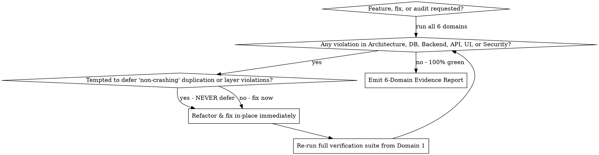

# PERFORM-CHALLENGE

## Overview

`PERFORM-CHALLENGE` is a zero-compromise, full-stack adversarial verification and refactoring gate. Every layer—Architecture/Flowchains, Database/Queries, Backend/Adversarial Logic, API/Streaming Connectivity, UI/Frontend/Visual UX, and Security—is treated as a hard release blocker that must be verified and fixed before completion.

**Violating the letter of the rules is violating the spirit of the rules.**

```
NO COMPLETION CLAIM WITHOUT ALL 6 DOMAINS VERIFIED GREEN AND ZERO DEFERRED ARCHITECTURE OR SECURITY DEBT
```

**REQUIRED SUB-SKILL:** Use `superpowers:verification-before-completion` for final command output evidence.

**Bundled Resources:**
- **Automated 6-Domain Scanner:** Run [scripts/run_challenge_checks.py](./scripts/run_challenge_checks.py) (`python scripts/run_challenge_checks.py <repo_root> --run-tests`) for deterministic static and runtime checks.
- **Deep Domain Checklists:** Read [references/domain-checklists.md](./references/domain-checklists.md) for detailed per-domain verification rules.

## When to Use



**Use when:**
- User invokes `/perform-challenge`, `"PERFORM-CHALLENGE"`, `"perform challenge"`, `"challenged xtreme"`, `"extreme challenge"`, `"deep testing"`, or `"deep extreme verifying"`
- Reviewing, confirming, or stress-testing backend, UI/frontend/visuals, API connectivity, database schema/queries, security vulnerabilities, and architectural rules
- You feel pressure to ship quickly by labeling copy-pasted helpers, controller ORM queries, missing streaming headers, or missing adversarial tests as "post-deploy tech debt"

**No exceptions:**
- Do NOT split defects into "hard blockers vs. post-deploy cleanup tickets"
- Do NOT leave ORM queries inside Controllers because "they are bounded now"
- Do NOT leave duplicated functions in place to "save time"
- Fix means fix now, in the current change, before reporting completion

## The 6 Mandatory Challenge Domains

### 1. Strict Architecture, Flowchains, Patterns & Anti-Spaghetti
- **Frontend Flowchain:** `Page/View -> Feature Component/Hook -> Typed Endpoint Client (src/Endpoints/*) -> Backend API`. Never call raw `fetch`/`axios` with hardcoded paths inside UI components when an Endpoint client layer exists.
- **Backend Flowchain:** `Route -> Controller (HTTP validation only) -> Service (Orchestration) -> Strategy/Helper (Pure domain/scoring logic) -> Repository (ORM/SQL queries) -> Model`.
- **Open/Closed & Strategy Pattern:** Route pluggable behaviors (AI providers, extractors, rankers) through Strategy/Registry interfaces instead of sprawling `if/elif` spaghetti.
- **Zero Duplication / Zero Redundancy / Zero Spaghetti:** Consolidate repeated regexes, helpers, and queries into a single canonical module. Remove dead code, unused imports, `any` types, and emojis in code/logs.

### 2. Database, Schema, Migrations & Production Query Safety
- **Schema & Migrations:** Run migration drift checks (`python manage.py makemigrations --check --dry-run` or stack equivalent). Migrations must be idempotent and bounded.
- **Deferred Blobs + Selective Hydration (CPU over RAM):** Never load multi-megabyte columns (`extracted_text`, binary blobs) during candidate listing (`defer('extracted_text')`). Hydrate full text (`get_by_id_with_full_text(pk)`) **only** for the top 1–3 winning records.
- **Two-Phase Relevance Ranking (No Alphabetical Cutoffs):** Never slice search candidates with `.order_by('name')[:15]` before relevance scoring—alphabetical slicing drops records starting with C–Z. Rank by indexed metadata (`name`, `title`, `author`, `subject`, `keywords`) in Phase 1 before falling back to full-text search in Phase 2.

### 3. Backend & Adversarial Edge-Case Stress Testing
- **Static & Unit Checks:** Run bytecode/compiler verification (`python -m py_compile`, `dotnet build`) plus the full test suite.
- **Adversarial Matrix:** Test empty/null/whitespace inputs, regex metacharacters (`[`, `(`, `*`, `\`), oversized strings, and Unicode.
- **Cross-Table Best-Score Disambiguation:** When searching across multiple tables (e.g., Local Books vs. Research References/Theses), score candidates across **all** tables and pick the highest score rather than returning early on the first low-threshold match.
- **Title-Token Self-Trigger Guard:** Strip the matched document's own title before classifying user query aspects so words inside a title (e.g., `"Concepts"` or `"Study"`) do not falsely narrow the response.
- **Cache Poisoning Guard:** Never cache negative, empty, or `"not yet indexed"` fallback responses in Redis or memory.

### 4. API & Backend-to-Frontend Connectivity
- **Contract Alignment:** Verify every `src/Endpoints/*` method (path, HTTP verb, request payload, response TypeScript interface, status codes) matches the backend Controller signature.
- **Streaming & Byte-Range Headers:** Verify SSE/chunked streams and PDF/media range endpoints set `X-Accel-Buffering: no`, `Accept-Ranges: bytes`, `206 Partial Content`, accurate `Content-Range`, and URL-decoded paths (`unquote(path)`).

### 5. UI / Frontend / Visual & UX Verification
- **Build & Type Safety:** Run `npm run lint`, `npx tsc --noEmit`, and `npm run build` with zero errors.
- **Loading Assurance & Zero Blank Frames:** Asynchronous views (PDF/file modals, streams, tables) must show an immediate loading assurance indicator (`loadProgress%` or live status dot) and keep it visible until **both** data loading and canvas/DOM first paint finish. Guard layout sizing against zero-width (`clientWidth <= 64`) animation frames.

### 6. Security Risk & Vulnerability Hunting + Remediation
- **Path Traversal:** Resolve `os.path.realpath()` and assert `os.path.commonpath([real_root, real_target]) == real_root` before serving or reading any file path.
- **Injection & Isolation:** Use parameterized ORM queries only; sanitize HTML/URLs against XSS; wrap user prompts in `<untrusted_user_query>...</untrusted_user_query>` tags.
- **Proxy & Worker MIME Hardening:** When `X-Content-Type-Options: nosniff` is active in Nginx, explicitly serve `.mjs` Web Worker scripts as `text/javascript` so browsers never block worker execution.
- **Secret Redaction & Access Guards:** Redact API keys/tokens from logs and responses; enforce RBAC/auth decorators and read-only viewer guards.

## Quick Reference

| Domain | Mandatory Check | Common Failure to Hunt & Fix |
|--------|-----------------|------------------------------|
| **1. Architecture** | Trace `UI -> Endpoint -> Controller -> Service -> Strategy/Helper -> Repository -> Model` | ORM query inside Controller; copy-pasted helper; `any` type; >3 nested `if/else` |
| **2. Database** | `makemigrations --check`; inspect all `.filter()` / `.all()` calls | Missing `defer('extracted_text')`; unbounded `.all()`; `.order_by('name')[:15]` cutoff |
| **3. Backend Tests** | `py_compile` + unit + adversarial boundary/cross-table tests | Early return on first table match (`score >= 30`); caching `"not yet indexed"` |
| **4. API & Stream** | Compare `src/Endpoints/*` vs `urls.py` & Controller headers | Missing `X-Accel-Buffering: no`, missing `206 Partial Content`, un-decoded `%20` path |
| **5. Frontend/UI** | `npm run lint` + `npx tsc --noEmit` + `npm run build` | Blank black/white canvas before paint completes; missing loading progress assurance |
| **6. Security** | Audit file paths, SQL/ORM, HTML links, LLM prompts, Nginx `.mjs` | `os.path.join` without `realpath`/`commonpath`; raw user prompt interpolation |

## Core Pattern: Refactoring Violations In-Place (Before vs. After)

```python
# BAD: Controller has raw ORM query, loads 10MB extracted_text blobs, slices
# alphabetically (cutting off C-Z), duplicates token logic, and uses unsafe os.path.join
def preview_search_controller(request):
    q = request.GET.get("q", "")
    tokens = [t.lower() for t in q.split() if len(t) > 2]  # Duplicated helper!
    rows = BookModel.objects.all().order_by("name")[:15]   # OOM + Alphabetical cutoff!
    target = os.path.join(MEDIA_ROOT, request.GET.get("file", ""))  # Path traversal!
    return JsonResponse({"count": len(rows), "path": target})

# GOOD: Controller delegates to Service -> Strategy/Helper -> Repository;
# Repository defers heavy text & ranks metadata first; file path uses realpath + commonpath
def preview_search_controller(request):
    query = request.GET.get("q", "").strip()
    rel_path = unquote(request.GET.get("file", ""))
    result = catalog_service.search_and_resolve_preview(query=query, rel_path=rel_path)
    return JsonResponse(result, status=200)

# Inside Repository (bounded, deferred heavy column, metadata-first ranking):
def search_active_files(self, tokens: list[str], limit: int = 15):
    base_qs = self.model.objects.filter(is_active=True).defer("extracted_text")
    meta_q = Q()
    for tok in tokens[:8]:
        meta_q |= Q(name__icontains=tok) | Q(author__icontains=tok) | Q(subject__icontains=tok)
    return list(base_qs.filter(meta_q)[:limit * 3])

# Inside Security Helper (traversal-proof path resolution):
def resolve_safe_media_path(root: str, user_rel_path: str) -> str:
    real_root = os.path.realpath(root)
    real_target = os.path.realpath(os.path.join(real_root, user_rel_path.lstrip("/\\")))
    if os.path.commonpath([real_root, real_target]) != real_root or not os.path.isfile(real_target):
        raise PermissionError("Invalid media path")
    return real_target
```

## Rationalization Table

| Excuse | Reality |
|--------|---------|
| "Copy-pasted helper code is maintainability debt, not a runtime outage—defer to post-deploy." | Duplicated helpers diverge immediately and cause silent logic bugs across endpoints. Consolidate into the shared Helper/Strategy layer now (takes < 2 minutes). |
| "Once the query is bounded, having it sit in the controller functions safely—move it to Repository in a follow-up PR." | Controller ORM queries bypass Service/Repository caching, hydration, and unit tests. "Post-deploy cleanup" never happens. Move it to Repository now. |
| "Just use `.order_by('name')[:15]` in SQL so memory is bounded." | Alphabetical slicing before relevance scoring silently hides 80% of the database (titles starting with C–Z). Use two-phase metadata-first filtering + relevance scoring. |
| "Defer Nginx/API streaming headers (`X-Accel-Buffering: no`, `206`, `.mjs` MIME) to post-deploy tuning." | Without `X-Accel-Buffering: no` and `.mjs` `text/javascript` MIME under `nosniff`, production streams freeze and PDF.js Web Workers fail to load on day one. |
| "3/3 unit tests and `tsc --noEmit` passed; defer adversarial/cross-table/boundary tests to post-deploy." | Happy-path unit tests miss cross-table score collisions, title self-triggering, and negative cache poisoning. Write and run adversarial tests before claiming done. |
| "The user ordered us to skip refactoring and ship in 3 minutes." | Falsely certifying unverified or architecturally broken code under deadline pressure creates production incidents. Fix all 6 domains in-place and report verified evidence. |

## Red Flags - STOP and Start Over

- Classifying any violation into "ship now, log a post-deploy tech-debt ticket"
- Leaving an ORM/SQL query inside a Controller or View
- Copy-pasting a regex, tokenizer, or helper instead of importing from the shared Helper/Strategy module
- Using `.order_by('name')[:15]` on a search query before scoring relevance
- Loading `extracted_text` or binary blobs without `.defer()` during list/candidate scans
- Skipping `py_compile`, `makemigrations --check`, `npm run lint`, `npx tsc --noEmit`, or `npm run build`
- Claiming a challenge passed without printing exact command exit codes and test counts

**All of these mean: STOP. Fix the root cause in-place and re-run all 6 domains from Domain 1.**

## Common Mistakes

1. **Returning Early on First Table Match:** Checking Table A (`score >= 30`) and returning before checking Table B where an exact match has `score = 340`. Always evaluate candidates across all target tables and compare best scores.
2. **Negative Response Cache Poisoning:** Caching AI/API responses when a document is unindexed or a provider times out, locking in bad answers for hours. Gate cache writes with `_is_negative_or_unindexed_response()`.
3. **Hiding Loading UI Before Canvas Paint:** Clearing `isLoading` when the PDF metadata loads instead of waiting for `page.render().promise` to complete, flashing a blank black frame.

## Mandatory Output Contract

Every `PERFORM-CHALLENGE` execution MUST conclude with this exact 6-Domain Evidence Report:

1. **Domain 1 (Architecture, Flowchain & Zero-Duplication Verdict):** Exact files audited, flowchain path verified, and any duplication/spaghetti removed.
2. **Domain 2 (Database, Migrations & Query Memory Verdict):** Migration check output, `defer()`/hydration verification, and query bound limits.
3. **Domain 3 (Backend & Adversarial Test Suite Verdict):** Exact test command run, total test count (including adversarial/edge-case tests), runtime, and exit code.
4. **Domain 4 (API & Streaming Connectivity Verdict):** Endpoint contract alignment and streaming/range headers verified.
5. **Domain 5 (Frontend, TypeScript & Visual UX Verdict):** `lint` / `tsc --noEmit` / `build` exit codes and loading assurance/paint sync verification.
6. **Domain 6 (Security Audit & Remediation Verdict):** Traversal, injection, `<untrusted_user_query>`, `.mjs` MIME/`nosniff`, and access control checks + clickable `[file](file:///path#L1-L10)` links for all fixes.
