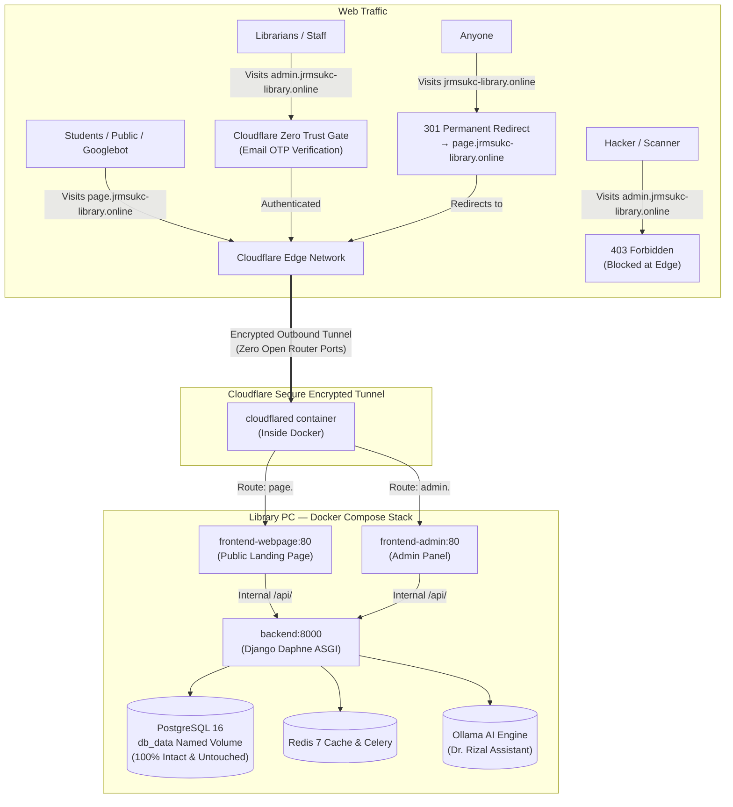

# JRMSU Library — Dual Subdomain Production Architecture & Deployment Guide
**Target Architecture:** Primary Domain Hidden | Dual Subdomains via Cloudflare Tunnel  
**Public Landing Page:** `https://page.jrmsukc-library.online` (Searchable on Google)  
**Librarian Admin Panel:** `https://admin.jrmsukc-library.online` (Unexposed / Protected by Cloudflare Access)  
**Primary Apex Domain:** `jrmsukc-library.online` (Protected / Auto-redirected to `page.`)  
**Target Hardware:** Production Library PC (migrating from old ngrok setup)

---

## 1. Executive Architecture Map



---

## 2. Core Safety Guarantees (The 4 Big Questions Answered)

### Q1: Will the database be changed, reset, or touched during the shift?
> [!IMPORTANT]
> **NO. The database is 100% INTACT and will NOT be touched.**
> 
> **Verified Evidence:**
> 1. We inspected Git history between the PC's current ngrok commit (`023a913`) and latest `main`. **There are ZERO new database migrations.** The latest migration remains migration `0036`.
> 2. The PostgreSQL database records, book inventory, users, and media live in Docker **named volumes** (`db_data` and `backend/media`), **not inside the Git repository folder**. Running `git pull`, stopping containers, or switching from ngrok to Cloudflare **never deletes or modifies named volumes**.
> 3. By pinning `COMPOSE_PROJECT_NAME=jrmsulibrary-web-page` in your `.env` (Section 5), Docker is guaranteed to reuse your existing database volume.

### Q2: Will Cloudflare recreate random URLs every time the PC restarts?
> [!IMPORTANT]
> **NO. The URLs are PERMANENT and FIXED FOREVER.**
> 
> Unlike free ngrok, which generates temporary links (`xyz-123.ngrok-free.app`) that break on reboot, Cloudflare Named Tunnels use a cryptographic permanent token (`CLOUDFLARE_TUNNEL_TOKEN`).
> - When your PC reboots or recovers from a brownout, Docker starts `cloudflared` automatically.
> - Within 5 seconds, `page.jrmsukc-library.online` and `admin.jrmsukc-library.online` **automatically reconnect to the exact same links**.
> - You will **never** need to re-share links with students or teachers again.

### Q3: What happens to `.env` when pulling on the PC?
- Because `.env` was historically tracked in Git, running `git pull` directly on the PC could overwrite your passwords.
- In **Section 5.2**, we provide the exact 5-command safe pull sequence that backs up your PC's `.env`, pulls the code, and restores your `.env` cleanly.

### Q4: How is the primary domain hidden while only the subdomain is exposed?
- In Cloudflare DNS and Cloudflare Rules, `jrmsukc-library.online` has **no public web root**. It automatically 301-redirects to `page.jrmsukc-library.online`.
- Only `page.` is submitted to Google Search Console and indexed.
- `admin.` is shielded by Cloudflare Access and has `X-Robots-Tag: noindex, nofollow`, keeping it completely out of Google search results.

---

## 3. GoDaddy to Cloudflare Nameserver Setup

Because you bought `jrmsukc-library.online` on GoDaddy (₱62.88 promo), you **do not transfer domain ownership**. You simply point GoDaddy's nameservers to Cloudflare (100% Free).

### Step 3.1: Add Domain in Cloudflare
1. Log in to [dash.cloudflare.com](https://dash.cloudflare.com).
2. Click **+ Add a Site** (or **Add domain**).
3. Type: `jrmsukc-library.online` (no `www`, no `http`).
4. Select the **Free ($0)** plan $\rightarrow$ click **Continue**.
5. Cloudflare will scan existing DNS records $\rightarrow$ click **Continue**.
6. Cloudflare will display **2 Assigned Nameservers**, for example:
   - `aria.ns.cloudflare.com`
   - `noah.ns.cloudflare.com`  
   *(Copy both nameservers)*.

### Step 3.2: Change Nameservers in GoDaddy
1. Log in to [godaddy.com](https://www.godaddy.com) $\rightarrow$ go to **My Products**.
2. Find `jrmsukc-library.online` $\rightarrow$ click **DNS** (or **Manage DNS**).
3. Scroll down to **Nameservers** $\rightarrow$ click **Change Nameservers**.
4. Select **"I'll use my own nameservers"** (Advanced).
5. Delete the old GoDaddy nameservers (`domaincontrol.com`) and paste the two Cloudflare nameservers.
6. Click **Save** $\rightarrow$ check **"Yes, I consent to update nameservers"** $\rightarrow$ confirm.

### Step 3.3: Delete GoDaddy Parking Records in Cloudflare
1. Go back to Cloudflare $\rightarrow$ navigate to **DNS $\rightarrow$ Records**.
2. **Delete** any default GoDaddy parking records:
   - Any `A` record pointing to a GoDaddy IP (e.g. `34.102.136.180`)
   - Any `CNAME` for `www` pointing to `@`
   *(If you don't delete them, the Cloudflare Tunnel cannot register those hostnames!)*

---

## 4. Google Searchability & SEO (.xml Sitemap Configuration)

To make `https://page.jrmsukc-library.online` searchable on Google while keeping `admin.` and primary hidden:

### 4.1 Create `frontend/public/sitemap.xml`
Create or update this file inside `frontend/public/sitemap.xml`:

```xml
<?xml version="1.0" encoding="UTF-8"?>
<urlset xmlns="http://www.sitemaps.org/schemas/sitemap/0.9">
  <url>
    <loc>https://page.jrmsukc-library.online/</loc>
    <lastmod>2026-10-12</lastmod>
    <changefreq>daily</changefreq>
    <priority>1.0</priority>
  </url>
  <url>
    <loc>https://page.jrmsukc-library.online/about</loc>
    <lastmod>2026-10-12</lastmod>
    <changefreq>weekly</changefreq>
    <priority>0.8</priority>
  </url>
  <url>
    <loc>https://page.jrmsukc-library.online/services</loc>
    <lastmod>2026-10-12</lastmod>
    <changefreq>weekly</changefreq>
    <priority>0.8</priority>
  </url>
  <url>
    <loc>https://page.jrmsukc-library.online/administration</loc>
    <lastmod>2026-10-12</lastmod>
    <changefreq>monthly</changefreq>
    <priority>0.7</priority>
  </url>
  <url>
    <loc>https://page.jrmsukc-library.online/personnel</loc>
    <lastmod>2026-10-12</lastmod>
    <changefreq>monthly</changefreq>
    <priority>0.7</priority>
  </url>
  <url>
    <loc>https://page.jrmsukc-library.online/collection</loc>
    <lastmod>2026-10-12</lastmod>
    <changefreq>daily</changefreq>
    <priority>0.9</priority>
  </url>
  <url>
    <loc>https://page.jrmsukc-library.online/physical-setup</loc>
    <lastmod>2026-10-12</lastmod>
    <changefreq>monthly</changefreq>
    <priority>0.7</priority>
  </url>
</urlset>
```

### 4.2 Create `frontend/public/robots.txt`
Create or update `frontend/public/robots.txt`:

```text
User-agent: *
Allow: /
Disallow: /admin
Disallow: /admin/
Disallow: /secure-admin-console/

Sitemap: https://page.jrmsukc-library.online/sitemap.xml
```

### 4.3 Add OpenGraph Meta Tags to `frontend/index.html`
Inside `<head>` in `frontend/index.html`:

```html
<meta name="description" content="Official website of the Jose Rizal Memorial State University Katipunan Campus Library: books, e-resources, online library services, and Dr. Rizal AI." />
<meta property="og:type" content="website" />
<meta property="og:site_name" content="JRMSU Katipunan Campus Library" />
<meta property="og:title" content="JRMSU Library | Katipunan Campus" />
<meta property="og:description" content="Access campus library services, book catalog, research references, and the Dr. Rizal AI assistant." />
<meta property="og:url" content="https://page.jrmsukc-library.online/" />
```

### 4.4 Submit to Google Search Console (Exact Steps)
1. Go to [search.google.com/search-console](https://search.google.com/search-console).
2. Click **Add Property**:
   - Choose **URL prefix**: `https://page.jrmsukc-library.online` (or Domain: `jrmsukc-library.online`).
3. Verification via Cloudflare DNS:
   - Copy the `TXT` verification token from Google (e.g., `google-site-verification=...`).
   - Go to Cloudflare $\rightarrow$ **DNS $\rightarrow$ Records $\rightarrow$ Add Record**:
     - Type: `TXT`
     - Name: `@`
     - Content: Paste the Google token.
   - Click **Save**.
4. In Google Search Console, click **Verify** $\rightarrow$ Instant verification!
5. In the left menu, click **Sitemaps**:
   - In "Add a new sitemap", type: `sitemap.xml`
   - Click **Submit**. Googlebot will now crawl and index `page.jrmsukc-library.online`.

---

## 5. Production PC Migration Runbook (Step-by-Step)

Perform this on the **Library PC** in **PowerShell (Administrator)** inside the project directory:

### Step 5.1: Create Pre-Flight Safety Backup (Data Never Lost)
```powershell
New-Item -ItemType Directory -Force C:\JRMSU_BACKUPS | Out-Null
$ts = Get-Date -Format "yyyy-MM-dd_HH-mm"

# 1. Back up existing .env
Copy-Item .env "C:\JRMSU_BACKUPS\env_backup_$ts.env"

# 2. Back up PostgreSQL database to a binary dump file
docker compose exec -T db pg_dump -U jrmsu_admin -d jrmsu_library -Fc -f /tmp/backup_pre_cloudflare.dump
docker compose cp db:/tmp/backup_pre_cloudflare.dump "C:\JRMSU_BACKUPS\db_backup_$ts.dump"

# 3. Archive uploaded media (book covers, student uploads)
Compress-Archive -Path .\backend\media\* -DestinationPath "C:\JRMSU_BACKUPS\media_backup_$ts.zip" -Force

Write-Host "Safety backup created in C:\JRMSU_BACKUPS!" -ForegroundColor Green
```

### Step 5.2: Stop Ngrok, Pull Latest Code, and Restore `.env`
```powershell
# 1. Stop the old ngrok container
docker compose stop ngrok

# 2. Stash local changes so git pull will never conflict
git stash push -m "pc-pre-cloudflare"

# 3. Pull the latest repository updates
git pull --ff-only origin main

# 4. Restore your PC's real .env file from backup
Copy-Item "C:\JRMSU_BACKUPS\env_backup_$ts.env" .env -Force
```

### Step 5.3: Update `.env` for Dual Subdomains & Cloudflare Token
Open `.env` in Notepad and update these lines:

```dotenv
# Pin compose project name to guarantee the SAME database volume is used
COMPOSE_PROJECT_NAME=jrmsulibrary-web-page

# Cloudflare Tunnel Token (obtained from Cloudflare Zero Trust in Section 6)
CLOUDFLARE_TUNNEL_TOKEN=eyJhIjoi...your_copied_token...

# Allow both subdomains + local IP for campus LAN
ALLOWED_HOSTS=page.jrmsukc-library.online,admin.jrmsukc-library.online,jrmsukc-library.online,localhost,127.0.0.1,192.168.1.50
ALLOWED_CORS_ORIGINS=https://page.jrmsukc-library.online,https://admin.jrmsukc-library.online,http://192.168.1.50:3000,http://192.168.1.50:3001

# Keep True for smooth local and proxied operation
DISABLE_SSL_REDIRECT=True

# Keep your existing DB_PASSWORD, REDIS_PASSWORD, SECRET_KEY unchanged!
```

### Step 5.4: Launch the Production Stack
```powershell
# Check config syntax
docker compose config --quiet

# Launch all containers (old ngrok is removed automatically)
docker compose up -d --build --remove-orphans

# Verify all containers are running
docker compose ps
docker compose logs --tail 20 cloudflared
```

---

## 6. Configuring Cloudflare Zero Trust & Tunnel Routes

In [one.dash.cloudflare.com](https://one.dash.cloudflare.com):

### 6.1 Create the Tunnel
1. Go to **Networks $\rightarrow$ Tunnels $\rightarrow$ Create a Tunnel**.
2. Name: `jrmsu-library-pc` $\rightarrow$ **Save**.
3. Select **Docker** $\rightarrow$ Copy the string after `--token` and paste it as `CLOUDFLARE_TUNNEL_TOKEN` in your `.env`.

### 6.2 Configure Public Hostname Routes

| Subdomain | Domain | Path | Service Type | Service URL | Purpose |
|---|---|---|---|---|---|
| `page` | `jrmsukc-library.online` | *(blank)* | `HTTP` | `frontend-webpage:80` | Public Landing Page |
| `admin` | `jrmsukc-library.online` | *(blank)* | `HTTP` | `frontend-admin:80` | Librarian Admin Panel |

### 6.3 Redirect Primary Domain (`jrmsukc-library.online` $\rightarrow$ `page.`)
To prevent the primary domain from being unconfigured or showing an error:
1. In Cloudflare Dashboard $\rightarrow$ select `jrmsukc-library.online`.
2. Go to **Rules $\rightarrow$ Redirect Rules $\rightarrow$ Create rule**.
3. **Rule name:** `Redirect Root to Page Subdomain`.
4. **Field / When incoming requests match:**
   - Hostname equals `jrmsukc-library.online` OR Hostname equals `www.jrmsukc-library.online`
5. **Then / URL redirect:**
   - Type: **Dynamic**
   - Expression: `concat("https://page.jrmsukc-library.online", http.request.uri.path)`
   - Status code: **301 (Permanent Redirect)**
   - Preserve query string: **Checked**
6. Click **Deploy**.

---

## 7. Securing the Admin Subdomain (Zero Public Exposure)

To guarantee the public and search engines **cannot access or find the admin panel**:

### 7.1 Setup Cloudflare Access (Email OTP Gate)
1. In Zero Trust Dashboard $\rightarrow$ **Access $\rightarrow$ Applications $\rightarrow$ Add an application $\rightarrow$ Self-hosted**.
2. **Application Settings:**
   - Application name: `JRMSU Library Admin Gate`
   - Application domain: `admin.jrmsukc-library.online`
   - Session Duration: `8 hours`
3. **Policy:**
   - Policy name: `Authorized Librarians Only`
   - Action: `Allow`
   - **Configure rules $\rightarrow$ Include:**
     - Selector: **Emails**
     - Values: `katipunan.library@jrmsu.edu.ph`, `librarian@jrmsu.edu.ph` (authorized emails).
4. Click **Next $\rightarrow$ Save application**.

> **Result:** When an outsider visits `https://admin.jrmsukc-library.online`, they are blocked by a Cloudflare One-Time PIN email verification screen. They cannot see the admin dashboard or Django login page without an authorized email.

### 7.2 Prevent Google from Indexing the Admin Subdomain
In `frontend/nginx.conf`, verify that the header is attached:

```nginx
# Automatically sends noindex header for any hostname starting with admin.
map $host $jrmsu_robots_tag {
    ~^admin\.  "noindex, nofollow";
    default    "";
}

server {
    ...
    add_header X-Robots-Tag $jrmsu_robots_tag always;
}
```

---

## 8. Rollback Procedure (Back to Ngrok in 3 Minutes)

If you ever need to roll back to the old ngrok setup:

```powershell
# 1. Stop current stack
docker compose down

# 2. Checkout previous commit (noted in backup)
git checkout 023a913

# 3. Restore original .env
Copy-Item "C:\JRMSU_BACKUPS\env_backup_<timestamp>.env" .env -Force

# 4. Start ngrok stack
docker compose up -d --build --remove-orphans
```

---

## 9. Verification Checklist

- [ ] GoDaddy nameservers updated to Cloudflare.
- [ ] GoDaddy default parking records deleted in Cloudflare DNS.
- [ ] Pre-flight safety backup created in `C:\JRMSU_BACKUPS`.
- [ ] PC `.env` updated with `CLOUDFLARE_TUNNEL_TOKEN` and `COMPOSE_PROJECT_NAME`.
- [ ] `docker compose up -d --build` completed with all 7 containers + `cloudflared` healthy.
- [ ] Visiting `https://page.jrmsukc-library.online` opens the Public Landing Page.
- [ ] Visiting `https://jrmsukc-library.online` auto-redirects to `https://page.jrmsukc-library.online`.
- [ ] Visiting `https://admin.jrmsukc-library.online` prompts for Cloudflare OTP email authentication.
- [ ] Chatting with Dr. Rizal AI generates real-time streaming answers.
- [ ] Google Search Console verified with `sitemap.xml` submitted.
- [ ] All books, accounts, and database records verified 100% intact!
