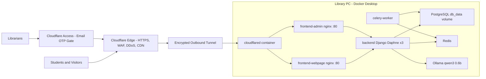

# JRMSU Library — Migration Guide: ngrok to Cloudflare Tunnel + Custom Domain

**Domain:** `jrmsukc-library.online` (registered at GoDaddy)
**Target machine:** Library production PC (currently running the ngrok setup)
**Source of truth:** GitHub `origin/main` (laptop work is already merged — PR #77 "Cloudflare")
**Golden rule:** Code gets updated. **Data (PostgreSQL, media uploads, Ollama model) is never touched.**

---

## 0. TL;DR — The Whole Migration in 12 Lines

1. (Laptop) Apply the small repo changes in **Section 4**, commit, push.
2. (Cloudflare) Add the domain, then switch GoDaddy nameservers to Cloudflare (**Section 5**).
3. (Cloudflare) Create a Tunnel and copy its **token** (**Section 5.4**).
4. (PC) Record the current state: commit, volumes, row counts (**Section 6.1**).
5. (PC) Back up: `.env`, PostgreSQL dump, media folder → `C:\JRMSU_BACKUPS` (**Section 6.2**).
6. (PC) Pin `COMPOSE_PROJECT_NAME` so Docker reuses the **same** database volume (**Section 6.3**).
7. (PC) Set aside local changes, `git pull`, restore `.env` (**Section 6.4**).
8. (PC) Edit `.env`: add tunnel token + domain, keep `DB_PASSWORD` unchanged (**Section 6.5**).
9. (PC) `docker compose up -d --build --remove-orphans` (ngrok is removed automatically).
10. (PC) Verify: tunnel connected, "No migrations to apply", row counts identical (**Section 6.7**).
11. (Cloudflare) Protect the admin with Cloudflare Access + WAF rules (**Section 7**).
12. (Google) Verify in Search Console and submit the sitemap (**Section 8**).

---

## 1. Findings From the Repository Analysis (Evidence)

These were verified directly in the repo on 2026-10-12, not assumed.

| # | Finding | Evidence | Impact |
|---|---|---|---|
| F1 | Laptop work is already on GitHub | `origin/main` = `18c4750 Merge pull request #77 from JMSuico/Cloudflare` | Nothing pending to push except Section 4 changes |
| F2 | **No new database migrations** since the ngrok commit `023a913` (2026-08-17) | `git diff --name-status 023a913 origin/main -- backend/Features/migrations` returns empty. Latest migration: `0036` (2026-08-13) | **Pulling will NOT change the database schema** |
| F3 | ngrok service was removed from `docker-compose.yml` | commit `034a2a6` | Old `ngrok` container becomes an "orphan" — removed with `--remove-orphans` |
| F4 | `db-standby` (streaming replica) and a `command:` line on `db` were added | `docker-compose.yml` lines 7, 21–51 | `db` container is recreated (volume kept). Replica may fail auth — harmless to primary (Section 6.8) |
| F5 | **CRITICAL: `.env` and `.env.docker` are tracked by git in a PUBLIC repo** | `git ls-files` lists both; repo is publicly readable; values are real (SECRET_KEY, DB_PASSWORD, Gmail app password, VitalSource, Scholaar, ngrok token) | Secrets must be rotated (Section 7.6). `.gitignore` does not untrack already-tracked files |
| F6 | `git pull` can overwrite or delete the PC's `.env` | Because `.env` is tracked | **Always back up `.env` before pulling** (Section 6.2) |
| F7 | Behind any tunnel, nginx sees every visitor as **one IP** (the tunnel container) | `frontend/nginx.conf` uses `$binary_remote_addr` for `limit_req` (10 r/s) and `limit_conn` (200) | All students share one rate-limit bucket → random 503 errors under load. Fixed in Section 4.2 |
| F8 | Django's client IP reads the first `X-Forwarded-For` value, which a visitor can spoof | `backend/core/middleware.py` L14–16 | Audit logs/analytics can be faked. Fixed in Section 4.2 |
| F9 | nginx forwards `X-Forwarded-Proto: http` even when the visitor used HTTPS | `nginx.conf` L89 `$scheme` | Django thinks requests are insecure → CSRF needs explicit origins, absolute URLs come out as `http://`. Fixed in Section 4.2 |
| F10 | AI chat is streamed (`StreamingHttpResponse`), but nginx buffers it | `ai_controller.py` L74; no `proxy_buffering off` | The reply appears all at once instead of typing out. Fixed in Section 4.2 |
| F11 | Hardcoded domain in code is `jrmsukclibrary.com`, **not** your domain | `settings.py` L242, L262–264; `nginx.conf` L53 | Harmless, but your domain must go in `.env` (Section 6.5) |
| F12 | Database volume name depends on the Compose **project name** (folder name) | `volumes: db_data:` | If the folder name or Compose version differs, Docker creates a **new empty** volume. It looks like data loss, but the data is still in the old volume. Prevented in Section 6.3 |
| F13 | `backup-db.ps1` uses PowerShell `>` redirection | `backup-db.ps1` L27 | On Windows PowerShell 5.1 this writes UTF-16, which makes a corrupted/unrestorable `.sql`. Use the binary-safe method in Section 6.2 |
| F14 | No `robots.txt`, `sitemap.xml`, or meta description | `frontend/public/`, `frontend/index.html` | Google can index it, but poorly. Fixed in Section 4.3 |
| F15 | The public site also contains `/admin` routes (same build for both containers) | `frontend/src/App.tsx` L137–163 | Protect `/admin` on the public host too (Section 7.2) |
| F16 | Django admin (`/secure-admin-console/`) is NOT reachable through nginx | `nginx.conf` only proxies `/api/`, `/ws/`, `/media/` | Good. Never route the tunnel directly to `backend:8000` |

---

## 2. Target Architecture



**Hostname routing (configured in the Cloudflare dashboard):**

| Public hostname | Routed to (inside Docker) | Who uses it |
|---|---|---|
| `jrmsukc-library.online` | `http://frontend-webpage:80` | Public, students, Google |
| `www.jrmsukc-library.online` | `http://frontend-webpage:80` (+ 301 redirect to apex) | Public |
| `admin.jrmsukc-library.online` | `http://frontend-admin:80` | Librarians only (behind Access) |

> [!IMPORTANT]
> Never create a public hostname pointing to `backend:8000`, `db:5432`, `redis:6379`, or `ollama:11434`.
> nginx already proxies `/api/`, `/ws/`, and `/media/` to the backend. Exposing anything else opens a direct attack path.

---

## 3. What Changes vs. What Stays Intact

| Component | During migration | Why |
|---|---|---|
| **PostgreSQL data** | **Untouched** | Lives in the `db_data` named volume. `git pull` never touches volumes. No new migrations (F2) |
| **Uploaded media** (`backend/media`) | **Untouched** | Git-ignored folder, bind-mounted |
| **Ollama model** | **Untouched** | `ollama_data` volume (no re-download if the project name is pinned) |
| **Admin accounts / passwords** | **Untouched** | Stored in the database |
| **`.env` secrets** | **Kept** (restored from backup) | You only **add** new keys |
| Frontend code | Updated to latest | Intended — rebuilt with `--build` |
| Backend code | Updated to latest | Intended — bind-mounted `./backend` |
| Redis cache | Reset if its password changes | No persistent volume in `docker-compose.yml`. **Do not migrate while a bulk email job is running** |
| ngrok | Removed | Replaced by `cloudflared` |
| User sessions | May log out | Only if you rotate `SECRET_KEY` (Section 7.6) |

**What can go wrong, and the guard for each:**

| Danger | Guard |
|---|---|
| `docker compose down -v` deletes volumes | **Never use `-v`.** Never run `docker volume prune` or `docker system prune --volumes` |
| New project name → new empty DB | Pin `COMPOSE_PROJECT_NAME` (Section 6.3) |
| Pull overwrites `.env` | Back up `.env` first and restore it after (Section 6.2 / 6.4) |
| Changing `DB_PASSWORD` in `.env` | Postgres only reads it on first init. Changing it breaks login to the DB (the data is still safe). Keep it unchanged; rotate properly later (Section 7.6) |
| Passwords containing `$` or `#` in `.env` | Compose treats `$` as a variable, and the settings loader strips `#` comments. Use only letters, digits, `-` and `_` in new secrets |

---

## 4. Phase A — Repository Changes (Do on the LAPTOP, then push)

These are small, backward-compatible changes. LAN access (`http://<PC-IP>:3000`) keeps working.

### 4.1 Add the `cloudflared` service to `docker-compose.yml`

Add this block before the top-level `volumes:` key. Add the same block to `docker-compose.prod.yml` for parity.

```yaml
  # ─── Layer 8: Cloudflare Tunnel (Public HTTPS entry — replaces ngrok) ───────
  # Outbound-only connection to Cloudflare. No ports are opened on the PC/router.
  # Hostname → service routing is configured in the Cloudflare Zero Trust dashboard.
  cloudflared:
    image: cloudflare/cloudflared:latest
    restart: unless-stopped
    command: tunnel --no-autoupdate run
    environment:
      TUNNEL_TOKEN: ${CLOUDFLARE_TUNNEL_TOKEN}
    depends_on:
      - frontend-webpage
      - frontend-admin
```

Notes:
- **No `ports:`.** That is the whole point: nothing is exposed.
- On the laptop (no token), this container just restarts in a loop. That's harmless. Stop it with `docker compose stop cloudflared` if it gets noisy.

### 4.2 Harden `frontend/nginx.conf` for the tunnel (real IP, HTTPS awareness, AI streaming, admin noindex)

**(a) Add at the very top of the file**, next to the existing `limit_req_zone` lines:

```nginx
# Cloudflare Tunnel: forward the scheme Cloudflare saw (https). Fall back to nginx's own scheme for LAN access.
map $http_x_forwarded_proto $jrmsu_forwarded_proto {
    default $http_x_forwarded_proto;
    ""      $scheme;
}

# Admin hostname must never appear in search engines (empty value = header not sent)
map $host $jrmsu_robots_tag {
    ~^admin\.  "noindex, nofollow";
    default    "";
}
```

**(b) Inside `server { ... }`, right after `resolver 127.0.0.11 valid=5s;`:**

```nginx
    # Real visitor IP from Cloudflare (cloudflared runs on the Docker network 172.16.0.0/12).
    # Without this, every internet visitor shares ONE rate-limit bucket (the tunnel's IP).
    set_real_ip_from 172.16.0.0/12;
    real_ip_header CF-Connecting-IP;

    add_header X-Robots-Tag $jrmsu_robots_tag always;
```

**(c) In the `location /api/`, `location /ws/`, and `location ^~ /media/` blocks**, replace the forwarding headers:

```diff
-        proxy_set_header X-Forwarded-For $proxy_add_x_forwarded_for;
-        proxy_set_header X-Forwarded-Proto $scheme;
+        # Overwrite (do not append) so visitors cannot spoof their IP
+        proxy_set_header X-Forwarded-For $remote_addr;
+        proxy_set_header X-Forwarded-Proto $jrmsu_forwarded_proto;
```

(The `/media/` block has neither line today. Add both lines there.)

**(d) Add a dedicated AI-chat location** above `location /api/` so streamed tokens reach the browser immediately:

```nginx
    # Dr. Rizal AI chat: disable buffering so the answer streams word-by-word through the tunnel
    location = /api/ai/chat/ {
        limit_req zone=api_limit burst=20 nodelay;
        set $ai_backend http://backend:8000;
        proxy_pass $ai_backend$request_uri;
        proxy_set_header Host $http_host;
        proxy_set_header X-Real-IP $remote_addr;
        proxy_set_header X-Forwarded-For $remote_addr;
        proxy_set_header X-Forwarded-Proto $jrmsu_forwarded_proto;
        proxy_buffering off;
        proxy_cache off;
        proxy_read_timeout 120s;
    }
```

> [!NOTE]
> Do **not** put any `add_header` inside these `location` blocks. In nginx, one `add_header` inside a location silently drops **all** the server-level security headers.

**Why (c) matters for Django:** once `X-Forwarded-Proto` is `https`, Django's existing `SECURE_PROXY_SSL_HEADER` (`settings.py` L338) treats requests as secure. CSRF same-origin checks then pass naturally, and absolute media URLs become `https://` (no mixed-content warnings).

### 4.3 SEO files (so Google can find and index the site)

**Create `frontend/public/robots.txt`:**

```text
User-agent: *
Allow: /
Disallow: /admin

Sitemap: https://jrmsukc-library.online/sitemap.xml
```

> [!WARNING]
> Do **NOT** add `Disallow: /api/`. The pages load their content from `/api/` in the browser. If Google can't fetch `/api/`, it sees empty pages.

**Create `frontend/public/sitemap.xml`** (the 7 public routes from `App.tsx`):

```xml
<?xml version="1.0" encoding="UTF-8"?>
<urlset xmlns="http://www.sitemaps.org/schemas/sitemap/0.9">
  <url><loc>https://jrmsukc-library.online/</loc><priority>1.0</priority></url>
  <url><loc>https://jrmsukc-library.online/about</loc></url>
  <url><loc>https://jrmsukc-library.online/services</loc></url>
  <url><loc>https://jrmsukc-library.online/administration</loc></url>
  <url><loc>https://jrmsukc-library.online/personnel</loc></url>
  <url><loc>https://jrmsukc-library.online/collection</loc></url>
  <url><loc>https://jrmsukc-library.online/physical-setup</loc></url>
</urlset>
```

**In `frontend/index.html`, add inside `<head>` below `<title>`:**

```html
    <meta name="description" content="Official website of the Jose Rizal Memorial State University Katipunan Campus Library: library hours, services, e-resources, book collections, and the Dr. Rizal AI library assistant." />
    <meta property="og:type" content="website" />
    <meta property="og:site_name" content="JRMSU Katipunan Campus Library" />
    <meta property="og:title" content="JRMSU Library | Katipunan Campus" />
    <meta property="og:description" content="Library hours, services, e-resources, collections, and the Dr. Rizal AI assistant." />
    <meta property="og:url" content="https://jrmsukc-library.online/" />
```

Do **not** add a static `<link rel="canonical">` to `index.html`. In a single-page app, it would mark every page as a duplicate of the home page.

### 4.4 `.env.example` — document the new keys

Append:

```dotenv
# ------------------------------------------------------------------------------
# 7. CLOUDFLARE TUNNEL (Production PC only)
# ------------------------------------------------------------------------------
# Token from Cloudflare Zero Trust > Networks > Tunnels > (your tunnel) > Docker command
CLOUDFLARE_TUNNEL_TOKEN=paste_tunnel_token_here
# Pin the Docker Compose project name so the SAME database volume is always reused.
# Must match the prefix shown by `docker volume ls` (e.g. jrmsulibrary-web-page_db_data)
# COMPOSE_PROJECT_NAME=jrmsulibrary-web-page
```

### 4.5 Stop tracking real secrets (fixes F5)

```powershell
git rm --cached .env .env.docker
git commit -m "chore(security): stop tracking .env files"
```

> [!CAUTION]
> After this is pushed, `git pull` on the PC will **delete** the PC's `.env` file. Git sees the file removed upstream.
> That is fine **only** if you followed Section 6.2 (backup) and Section 6.4 (restore). The runbook below handles it.
> Removing the file from tracking does **not** erase it from git history. **Rotating the secrets (Section 7.6) is the real fix.**

### 4.6 Keep this guide in git

`.gitignore` ignores `*.md` except whitelisted files. Add this line to the whitelist block:

```gitignore
!CLOUDFLARE_TUNNEL_MIGRATION.md
```

### 4.7 (Recommended, after go-live) Remove shared-domain wildcards from CSRF trust

`settings.py` L259–273 trusts `https://*.ngrok-free.dev`, `https://*.trycloudflare.com`, `https://*.workers.dev`, and others. **Anyone** can get a subdomain on those services. Once the domain works, reduce the list to your own hosts:

```diff
 CSRF_TRUSTED_ORIGINS = CORS_ALLOWED_ORIGINS + [
     "http://127.0.0.1",
     "http://localhost",
-    "https://www.jrmsukclibrary.com",
-    "https://jrmsukclibrary.com",
-    "https://*.jrmsukclibrary.com",
-    "https://*.trycloudflare.com",
-    "https://*.cloudflare.com",
-    "https://*.workers.dev",
-    "https://*.ngrok-free.dev",
-    "https://*.ngrok-free.app",
-    "https://*.ngrok.io",
-    "https://*.ngrok.app",
-    "https://dosage-dormitory-shadily.ngrok-free.dev"
 ]
```

Your domains still come in through `ALLOWED_CORS_ORIGINS` in `.env`, which is merged into `CORS_ALLOWED_ORIGINS`. Do this as a **separate** change after the migration is verified: one change at a time.

### 4.8 Validate and push (laptop)

```powershell
docker compose config --quiet            # must print nothing (valid YAML)
docker compose up -d --build frontend-webpage
docker compose exec frontend-webpage nginx -t   # must say "syntax is ok"
git add docker-compose.yml docker-compose.prod.yml frontend/nginx.conf frontend/public/robots.txt frontend/public/sitemap.xml frontend/index.html .env.example .gitignore CLOUDFLARE_TUNNEL_MIGRATION.md
git commit -m "feat(deploy): Cloudflare Tunnel service, tunnel-aware nginx, SEO files"
git push origin main   # or push a branch and merge via PR as usual
```

---

## 5. Phase B — Cloudflare + GoDaddy Setup (any browser)

### 5.1 Create a Cloudflare account and add the domain

1. Go to <https://dash.cloudflare.com> → sign up / log in (enable **2FA** on the account).
2. **Add a domain** → enter `jrmsukc-library.online` → choose the **Free** plan.
3. Cloudflare imports the existing GoDaddy DNS records. **Delete** any GoDaddy "parking" records:
   - `A  @  → (GoDaddy parking IP)`
   - `CNAME  www → @` or `www → jrmsukc-library.online`

   If you leave them, creating the tunnel hostnames fails with *"A record with that host already exists"*.
4. Cloudflare shows **two nameservers**, for example `xxx.ns.cloudflare.com` and `yyy.ns.cloudflare.com`. Copy them.

### 5.2 Point GoDaddy to Cloudflare

1. GoDaddy → **My Products** → `jrmsukc-library.online` → **DNS** → **Nameservers** → **Change Nameservers**.
2. If **DNSSEC** is ON at GoDaddy, turn it **OFF first**. Otherwise the domain breaks during the switch.
3. Choose **"I'll use my own nameservers"** → paste both Cloudflare nameservers → **Save** → confirm.
4. Back in Cloudflare, click **Check nameservers**. Status becomes **Active** in anywhere from 5 minutes to 24 hours. Cloudflare emails you when it's active.

> [!WARNING]
> **Renewal price:** ₱62.88 is a first-year promo. GoDaddy `.online` renewals are usually many times higher.
> Check the renewal price in GoDaddy → **My Products → Renewal settings**, and decide on auto-renew now.
> After 60 days (ICANN transfer lock), you may transfer the domain to Cloudflare Registrar (at-cost, no markup) if it lists `.online` as supported.

### 5.3 SSL/TLS and speed settings (domain dashboard)

| Setting | Location | Value |
|---|---|---|
| Encryption mode | SSL/TLS → Overview | **Full (strict)**. If you ever see SSL errors, use **Full** |
| Always Use HTTPS | SSL/TLS → Edge Certificates | **On** |
| Minimum TLS Version | SSL/TLS → Edge Certificates | **TLS 1.2** |
| TLS 1.3 | SSL/TLS → Edge Certificates | **On** |
| Automatic HTTPS Rewrites | SSL/TLS → Edge Certificates | **On** |
| HSTS | SSL/TLS → Edge Certificates | Leave **off** here. nginx already sends HSTS. Do **not** submit to hstspreload.org yet |
| WebSockets | Network | **On** (default) |
| Rocket Loader | Speed → Optimization | **Off**. It breaks React apps and the CSP |
| Caching | Caching → Configuration | Default. **Never** create a "Cache Everything" rule (it would cache API data and admin pages) |
| DNSSEC | DNS → Settings | Enable after the domain is Active, then add the DS record Cloudflare shows into GoDaddy → DNS → DNSSEC |

### 5.4 Create the Tunnel and get the token

1. Open **Zero Trust**: <https://one.dash.cloudflare.com>. On first use, pick a team name and the **Free** plan (Free = up to 50 Access users, $0).
2. **Networks → Tunnels** (newer UI: **Networks → Connectors → Cloudflare Tunnels**) → **Create a tunnel** → type **Cloudflared**.
3. Name: `jrmsu-library-pc` → **Save tunnel**.
4. On "Install and run a connector", choose **Docker**. It shows a command like:
   `docker run cloudflare/cloudflared:latest tunnel --no-autoupdate run --token eyJhIjoi...`
   Copy **only the long token after `--token`**. Don't run that command; our compose file runs it.
5. **Next** → add **Public Hostnames** (newer UI: **Published application routes**):

| Subdomain | Domain | Path | Service Type | URL |
|---|---|---|---|---|
| *(empty)* | `jrmsukc-library.online` | *(empty)* | HTTP | `frontend-webpage:80` |
| `www` | `jrmsukc-library.online` | *(empty)* | HTTP | `frontend-webpage:80` |
| `admin` | `jrmsukc-library.online` | *(empty)* | HTTP | `frontend-admin:80` |

6. **Save.** Cloudflare automatically creates the proxied DNS `CNAME` records pointing to `<tunnel-id>.cfargotunnel.com`.

> [!IMPORTANT]
> The tunnel token is a password. Anyone with it can attach their own server to your domain.
> Store it **only** in the PC's `.env`. Never commit it, screenshot it, or paste it into chat.
> If it leaks: Tunnel → **Configure → Refresh/Rotate token**, then update `.env`.

### 5.5 Redirect `www` to the main domain (one canonical URL for Google)

Domain dashboard → **Rules → Redirect Rules → Create rule**:
- If: **Hostname** equals `www.jrmsukc-library.online`
- Then: **Dynamic redirect**, expression `concat("https://jrmsukc-library.online", http.request.uri.path)`, status **301**, **preserve query string** on.

---

## 6. Phase C — Production PC Runbook (step by step)

Run every command in **PowerShell**, inside the project folder on the PC.
Do this at a quiet time (no class, no bulk email job). Expected downtime: 5–15 minutes, mostly the frontend rebuild.

### 6.1 Record the current state (your "before" snapshot)

```powershell
New-Item -ItemType Directory -Force C:\JRMSU_BACKUPS | Out-Null
$ts = Get-Date -Format "yyyy-MM-dd_HH-mm"

git rev-parse HEAD | Tee-Object C:\JRMSU_BACKUPS\old_commit.txt     # write this down — your rollback point
git status --short                                                  # local modifications on the PC
git log origin/main..HEAD --oneline                                 # MUST be empty (PC should never have its own commits)
docker compose ps
docker compose ls
docker volume ls | Select-String "db_data|ollama_data|db_standby"   # note the exact prefix, e.g. jrmsulibrary-web-page_db_data
```

> [!WARNING]
> If `git log origin/main..HEAD` shows commits, **stop**. Someone committed on the PC. Copy those changes out first before pulling.

**Row-count fingerprint** (read-only; counts every table exactly):

```powershell
@'
SELECT table_name,
       (xpath('/row/c/text()', query_to_xml(format('SELECT count(*) AS c FROM %I.%I', table_schema, table_name), false, true, '')))[1]::text::int AS row_count
FROM information_schema.tables
WHERE table_schema = 'public' AND table_type = 'BASE TABLE'
ORDER BY table_name;
'@ | Set-Content -Encoding ascii C:\JRMSU_BACKUPS\rowcount.sql

Get-Content C:\JRMSU_BACKUPS\rowcount.sql | docker compose exec -T db psql -U jrmsu_admin -d jrmsu_library | Set-Content -Encoding utf8 "C:\JRMSU_BACKUPS\rowcount_BEFORE_$ts.txt"
Get-Content "C:\JRMSU_BACKUPS\rowcount_BEFORE_$ts.txt" | Select-Object -First 15
```

### 6.2 Back up everything (binary-safe; outside the git folder)

```powershell
# 1) Secrets file
Copy-Item .env "C:\JRMSU_BACKUPS\env_backup_$ts.env"
if (Test-Path .env.docker) { Copy-Item .env.docker "C:\JRMSU_BACKUPS\env_docker_backup_$ts.env" }

# 2) PostgreSQL — custom format (-Fc) written INSIDE the container, then copied out (avoids the PowerShell UTF-16 corruption in F13)
docker compose exec -T db pg_dump -U jrmsu_admin -d jrmsu_library -Fc -f /tmp/pre_cloudflare.dump
docker compose cp db:/tmp/pre_cloudflare.dump "C:\JRMSU_BACKUPS\jrmsu_db_pre_cloudflare_$ts.dump"
docker compose exec -T db pg_restore -l /tmp/pre_cloudflare.dump | Select-Object -First 5   # proves the dump is readable

# 3) Uploaded media (book covers, PDFs, images)
Compress-Archive -Path .\backend\media\* -DestinationPath "C:\JRMSU_BACKUPS\media_$ts.zip" -Force

Get-ChildItem C:\JRMSU_BACKUPS | Format-Table Name, Length, LastWriteTime
```

Copy `C:\JRMSU_BACKUPS` to a USB drive or Google Drive before continuing.

**Optional cold snapshot of the raw volume** (strongest guarantee; needs a ~1 minute DB stop). Replace the volume name with the one from 6.1:

```powershell
docker compose stop backend celery-worker db
docker run --rm -v jrmsulibrary-web-page_db_data:/data:ro -v C:\JRMSU_BACKUPS:/backup alpine tar czf /backup/db_data_volume_$ts.tgz -C /data .
docker compose start db
```

### 6.3 Pin the Compose project name (prevents the "empty database" scare — F12)

Take the prefix from `docker volume ls`. For example, `jrmsulibrary-web-page_db_data` → prefix `jrmsulibrary-web-page`. Old Compose v1 would show `jrmsulibrarywebpage_db_data` → prefix `jrmsulibrarywebpage`.

Add this line to the **top** of the PC's `.env`, and to your backup copy:

```dotenv
COMPOSE_PROJECT_NAME=jrmsulibrary-web-page
```

Now every `docker compose` command reuses the **existing** `..._db_data` and `..._ollama_data` volumes. It does this regardless of folder name or Compose version.

### 6.4 Stop ngrok, set local changes aside, pull

```powershell
# Stop only the public ngrok tunnel (site stays reachable on LAN meanwhile)
docker compose stop ngrok

# See what the pull will bring (this is the "--diff" review step)
git fetch origin
git diff --stat HEAD origin/main
git diff HEAD origin/main -- docker-compose.yml frontend/nginx.conf backend/core/settings.py

# Set aside PC-local modifications to TRACKED files (.env, .pyc, FAQ cache...) so the pull cannot conflict.
# .env is already safely backed up in C:\JRMSU_BACKUPS.
git stash push -m "pc-local-before-cloudflare-$ts"

git pull --ff-only origin main
```

What you should expect in the diff:
- `docker-compose.yml`: **removes** `ngrok`, **adds** `db-standby` and `cloudflared`, adds `command:` to `db`.
- `frontend/nginx.conf`: real-IP and forwarding-header changes, AI chat location.
- New frontend features, `backup-db.ps1`, `restore-db.ps1`, `failover-to-standby.ps1`, and the SEO files.
- **No new files in `backend/Features/migrations/`.**

**Restore the PC's own `.env`** (the pull may have deleted or replaced it):

```powershell
Copy-Item "C:\JRMSU_BACKUPS\env_backup_$ts.env" .env -Force
git status --short   # .env should NOT appear as tracked anymore once Section 4.5 is in main
```

> [!NOTE]
> Do **not** `git stash pop`. That would bring back old `.pyc` files and the old tracked `.env`. Leave the stash as a reference. `git stash list` shows it, and you can delete it weeks later with `git stash drop`.

If `git pull --ff-only` refuses, the PC has diverged. Do **not** force anything. Run `git status` and `git log --oneline -5 HEAD origin/main`, then ask for help.

### 6.5 Edit the PC's `.env`

Open `.env` in Notepad and make **only** these changes:

```dotenv
COMPOSE_PROJECT_NAME=jrmsulibrary-web-page            # from 6.3

# NEW — Cloudflare Tunnel token from Section 5.4 step 4
CLOUDFLARE_TUNNEL_TOKEN=eyJhIjoi...your_token...

# Domain allow-lists (replace 192.168.1.50 with the PC's static LAN IP)
ALLOWED_HOSTS=jrmsukc-library.online,www.jrmsukc-library.online,admin.jrmsukc-library.online,localhost,127.0.0.1,192.168.1.50
ALLOWED_CORS_ORIGINS=https://jrmsukc-library.online,https://www.jrmsukc-library.online,https://admin.jrmsukc-library.online,http://192.168.1.50:3000,http://192.168.1.50:3001

# KEEP AS-IS for now (Cloudflare enforces HTTPS at the edge; LAN http access keeps working)
DISABLE_SSL_REDIRECT=True

# DO NOT CHANGE in this step
# DB_PASSWORD=...   (unchanged — see Section 7.6 for the safe rotation procedure)

# REMOVE (no longer used)
# NGROK_AUTHTOKEN=...
```

Why `DISABLE_SSL_REDIRECT=True` stays:
- Setting it to `False` makes Django redirect LAN users from `http://192.168.x.x:3000` to `https://192.168.x.x:3000`, which doesn't exist.
- Internet users are already forced to HTTPS by Cloudflare "Always Use HTTPS" and the HSTS header.

### 6.6 Validate, then start

```powershell
docker compose config --quiet                                          # must print nothing
docker compose run --rm --no-deps backend python manage.py migrate --plan   # expect: "No planned migration operations."
docker compose up -d --build --remove-orphans
```

`--remove-orphans` deletes the old `ngrok` container, not any volume.

### 6.7 Verify (your "after" proof)

```powershell
docker compose ps                                   # all Up; ollama-init "Exited (0)" is normal
docker compose logs --tail 30 cloudflared           # expect 4x "Registered tunnel connection"
docker compose logs --tail 30 backend | Select-String "migrat"   # expect "No migrations to apply"
docker volume ls | Select-String "db_data"          # SAME volume name as in 6.1, no new one

# Row counts must match the BEFORE file exactly
Get-Content C:\JRMSU_BACKUPS\rowcount.sql | docker compose exec -T db psql -U jrmsu_admin -d jrmsu_library | Set-Content -Encoding utf8 "C:\JRMSU_BACKUPS\rowcount_AFTER_$ts.txt"
Compare-Object (Get-Content "C:\JRMSU_BACKUPS\rowcount_BEFORE_$ts.txt") (Get-Content "C:\JRMSU_BACKUPS\rowcount_AFTER_$ts.txt")
# No output = identical = database intact
```

**Browser checks** (use a phone on **mobile data**, not the library Wi-Fi, so you test the real internet path):

| Test | Expected |
|---|---|
| `https://jrmsukc-library.online` | Home page loads, padlock shown |
| `http://jrmsukc-library.online` | Redirects to `https://` |
| `https://www.jrmsukc-library.online/about` | 301 → `https://jrmsukc-library.online/about` |
| Ask Dr. Rizal a question | Answer appears and types out progressively |
| Collection / e-resources pages | Data and images load (no mixed-content warnings) |
| Submit feedback / contact form | Succeeds (no 403 CSRF error) |
| `https://admin.jrmsukc-library.online` | Cloudflare Access email-code page first, then the admin login |
| Admin login + edit content | Works; the change appears on the public site |
| LAN: `http://<PC-IP>:3000` | Still works for on-campus users |
| Old ngrok URL | No longer reachable |

### 6.8 `db-standby` check (new replica container)

```powershell
docker compose logs --tail 20 db-standby
```

- `Starting PostgreSQL in standby streaming mode` with no errors → replica works.
- `no pg_hba.conf entry for replication connection` → the replica can't authenticate.
  This **does not affect the primary database**. Stop it for now with `docker compose stop db-standby` and fix it later as a separate task.

### 6.9 Auto-start after reboot or power loss

- `EnableAutoStart.bat` already runs `docker-compose up -d --build`. `cloudflared` is now part of the stack, so the tunnel comes back automatically.
- If ngrok was ever installed **on Windows itself** (outside Docker), remove it. Check Task Scheduler and `shell:startup` for any `ngrok` entry and delete it.
- Windows: **Power & sleep → Never**. BIOS: **Restore on AC power loss → Power On**. Use a UPS for the PC and router.

---

## 7. Phase D — Securing the Tunnel and the Site

### 7.1 Why the tunnel itself is secure

- The PC makes an **outbound** encrypted connection to Cloudflare. **No router port forwarding, no open inbound ports.**
- The PC's real public IP is hidden. Attackers can only reach Cloudflare, which absorbs DDoS.
- Only the hostnames you configured are reachable, and only to the two nginx containers.

### 7.2 Protect the admin with Cloudflare Access (strongly recommended, free)

Zero Trust → **Access → Applications → Add an application → Self-hosted**:

1. Name `JRMSU Admin`. Destinations / public hostnames:
   - `admin.jrmsukc-library.online` (whole host)
   - `jrmsukc-library.online` with path `admin`, and `jrmsukc-library.online` with path `admin/*`. These close F15, because the public build also contains `/admin`.
2. Session duration: **8 hours** (matches Django's `SESSION_COOKIE_AGE`).
3. Policy: **Allow** → Include → **Emails** → list each librarian's email, e.g. `katipunan.library@jrmsu.edu.ph`.
4. Login method: **One-time PIN** (default; a code is emailed).

Result: before anyone even sees the admin login page, they must prove they own a listed email. Django's own login, 5-attempt lockout, and single-device sessions still apply behind it.

### 7.3 WAF custom rules (Free plan allows 5)

Domain → **Security → WAF → Custom rules → Create**:

**Rule 1 — Block sensitive paths** (Action: **Block**)
```text
(starts_with(http.request.uri.path, "/secure-admin-console")) or (starts_with(http.request.uri.path, "/api/docs")) or (starts_with(http.request.uri.path, "/api/schema")) or (http.request.uri.path contains "/.env") or (http.request.uri.path contains "/.git")
```

**Rule 2 (optional) — Challenge non-Philippine traffic to the admin host** (Action: **Managed Challenge**)
```text
(http.host eq "admin.jrmsukc-library.online" and ip.src.country ne "PH")
```

### 7.4 Rate-limit login at the edge (Free plan allows 1 rule)

**Security → WAF → Rate limiting rules → Create**:
- Expression: `(http.request.uri.path eq "/api/users/login/" and http.request.method eq "POST")`
- Characteristics: IP. Rate: **5 requests per 10 seconds**. Action: **Block** for 10 seconds.

This stops floods at Cloudflare before they reach the PC. Django's per-username lockout still applies.

### 7.5 Bots

- **Security → Bots → Bot Fight Mode**: optional. Verified crawlers like Googlebot are allowed. After enabling it, re-test the AI chat and forms from a phone. If anything breaks, turn it off.
- nginx already blocks scanners (`nikto`, `sqlmap`, `nmap`, and others) and dotfile probes.

### 7.6 Rotate the leaked secrets (F5) — do AFTER the migration is verified, one at a time

The old values are public in git history. Treat them as compromised.

| Secret | How to rotate | Side effect |
|---|---|---|
| Gmail app password (`EMAIL_HOST_PASSWORD`) | Google Account → Security → App passwords → **revoke** old, create new → put in `.env` → `docker compose up -d` | None |
| VitalSource / Scholaar passwords | Change on their websites → update `.env` → `docker compose up -d` | None |
| ngrok token | ngrok dashboard → **Reset authtoken** (no longer used anyway) | None |
| `SECRET_KEY` | Generate: `docker compose exec backend python -c "import secrets; print(secrets.token_urlsafe(50))"` → `.env` → `docker compose up -d` | Everyone is logged out once. Password-reset links in flight become invalid |
| `REDIS_PASSWORD` (currently a placeholder value) | Generate a new value the same way → `.env` → `docker compose up -d` | Redis restarts empty (cache and queued tasks cleared) |
| `DB_PASSWORD` | **Special procedure below** | None if done in order |

**DB password — the only safe order** (changing `.env` alone does NOT change Postgres):

```powershell
docker compose exec db psql -U jrmsu_admin -d jrmsu_library
# inside psql:
\password jrmsu_admin
# type the NEW password twice (letters/digits/-/_ only), then:
\q
```

Then put the **same** new value in `.env` as `DB_PASSWORD` and run `docker compose up -d`. The `db` container is recreated, but data is kept; Postgres does not re-initialize an existing volume.

Use **only** letters, digits, `-` and `_` in new secrets (no `$` or `#`, see Section 3).

### 7.7 Ongoing hygiene

- Keep Docker Desktop and Windows updated. Monthly: `docker compose pull cloudflared ollama redis db` then `docker compose up -d`.
- Windows Firewall: allow ports 3000/3001 on **Private** networks only (LAN). They are never exposed to the internet by the tunnel setup.
- Back up weekly with the Section 6.2 commands, and keep one copy off the PC.
- The PC is production: **pull-only**. Never commit or push from it.

---

## 8. Phase E — Making the Site Searchable on Google

1. Open **Google Search Console**: <https://search.google.com/search-console> → **Add property** → **Domain** → `jrmsukc-library.online`.
2. Google gives a **TXT record**. Add it in Cloudflare → DNS → Records → **Add record** → Type `TXT`, Name `@`, Content = the Google value.
   (Search Console may offer to add it automatically via its Cloudflare integration.) Click **Verify**.
3. **Sitemaps** → submit `https://jrmsukc-library.online/sitemap.xml`.
4. **URL Inspection** → enter the home page → **Test live URL** → **View tested page → Screenshot**.
   - If the screenshot shows the real page, Google can render the React app.
   - If it is blank or stuck on the loader, the DevTools-protection or privacy modal may be blocking the crawler. Report it and it can be adjusted.
5. **Request indexing** for the home page and the main pages.

What to expect:
- Indexing takes **days to a few weeks** for a new domain.
- Searching "JRMSU Katipunan Library" will rank better when other sites link to it: the official JRMSU site, the library Facebook page, and student portals. Ask the university to link to `https://jrmsukc-library.online`.
- The PC must be **online** when Googlebot visits. Long outages hurt ranking.
- The admin host sends `X-Robots-Tag: noindex` (Section 4.2), so it never appears in Google.

---

## 9. Performance Notes

| Topic | Reality |
|---|---|
| Added latency | About 10–40 ms. Cloudflare's nearest edge is in Manila |
| Static files (JS/CSS/images) | Cached at Cloudflare's edge (nginx already sends 1-year immutable cache headers), so they load fast and reduce load on the PC |
| API / AI | Always reaches the PC. Speed depends on the PC's CPU/RAM and the **upload** speed of the library internet |
| AI timeout | Cloudflare closes requests that send no data for **100 s**. With streaming enabled (Section 4.2d), the first words arrive within seconds, so this does not trigger. Backend Ollama timeout is 120 s |
| Shared rate limit (F7) | Fixed by `real_ip_header CF-Connecting-IP`. Each student now has their own limit |
| Uptime | The site is up only while the PC, Docker, and the internet connection are up. Visitors see **Cloudflare Error 1033 / 502** when the PC is down |

---

## 10. Rollback Plan (back to ngrok in about 5 minutes)

The database volume is untouched by every step, so rollback is code-only.

```powershell
$old = Get-Content C:\JRMSU_BACKUPS\old_commit.txt
docker compose down                      # NO -v  (volumes stay)
git checkout $old
Copy-Item C:\JRMSU_BACKUPS\env_backup_<timestamp>.env .env -Force   # the original .env with NGROK_AUTHTOKEN
docker compose up -d --build --remove-orphans
```

Return to the latest code later with `git checkout main`.

**Only for a disaster** (data actually damaged — not expected): restore the dump.

```powershell
docker compose cp "C:\JRMSU_BACKUPS\jrmsu_db_pre_cloudflare_<timestamp>.dump" db:/tmp/restore.dump
docker compose stop backend celery-worker
docker compose exec -T db pg_restore -U jrmsu_admin -d jrmsu_library --clean --if-exists /tmp/restore.dump
docker compose start backend celery-worker
```

> [!CAUTION]
> `pg_restore --clean` **replaces** the current database contents with the backup.
> Only run it if you have confirmed the data is damaged. Make a fresh dump first if unsure.

---

## 11. Troubleshooting

| Symptom | Cause | Fix |
|---|---|---|
| Admin shows **zero books / empty site** after `up` | New project name → new empty volume (F12) | `docker compose down` (no `-v`), set the correct `COMPOSE_PROJECT_NAME`, `up -d` again. Old data is still in the old volume |
| Cloudflare **Error 1033** | `cloudflared` not running or bad token | `docker compose logs cloudflared`; re-copy the token into `.env`; `docker compose up -d cloudflared` |
| Cloudflare **502 Bad Gateway** | Wrong service URL in Public Hostname, or frontend container down | URL must be exactly `frontend-webpage:80` / `frontend-admin:80`; check `docker compose ps` |
| **400 Bad Request** on API | Domain missing from `ALLOWED_HOSTS` | Add it in `.env` → `docker compose up -d` |
| **403 CSRF failed** on forms/login | Domain missing from `ALLOWED_CORS_ORIGINS`, or nginx change 4.2(c) not applied | Add `https://...` origins to `.env`; confirm the nginx changes are in the pulled code |
| **Too many redirects** | `DISABLE_SSL_REDIRECT=False` without the nginx proto fix | Set back to `True` |
| **524 timeout** on AI | Very long generation with buffering on | Confirm the 4.2(d) AI location exists; PC may be overloaded |
| Tunnel hostname creation fails: "record already exists" | GoDaddy parking records were imported | Delete the old `A @` / `CNAME www` records in Cloudflare DNS |
| Domain stays "Pending" | Nameservers not saved at GoDaddy, or DNSSEC still on there | Re-check GoDaddy nameservers; disable GoDaddy DNSSEC |
| `git pull` says "local changes would be overwritten" | Stash step skipped | Section 6.4: back up `.env`, `git stash push`, pull again |
| Students get **503** under load | Real-IP fix not applied (F7) | Confirm `real_ip_header CF-Connecting-IP` in the running nginx: `docker compose exec frontend-webpage cat /etc/nginx/conf.d/default.conf` |

---

## 12. Final Checklist

- [ ] Section 4 changes committed and pushed from the laptop
- [ ] Domain **Active** on Cloudflare; GoDaddy nameservers switched
- [ ] Tunnel created; 3 public hostnames added; token stored only in the PC `.env`
- [ ] PC: old commit, volume names, and row counts recorded
- [ ] PC: `.env`, DB dump, and media backed up to `C:\JRMSU_BACKUPS` + off-PC copy
- [ ] PC: `COMPOSE_PROJECT_NAME` pinned
- [ ] PC: pulled, `.env` restored and edited, `up -d --build --remove-orphans`
- [ ] Row counts BEFORE = AFTER; same `db_data` volume; "No migrations to apply"
- [ ] Mobile-data browser tests pass (site, AI, forms, admin via Access, LAN still works)
- [ ] Cloudflare Access on the admin; WAF rules; login rate-limit rule
- [ ] Leaked secrets rotated (Section 7.6), DB password last, using the `\password` procedure
- [ ] Search Console verified; sitemap submitted
- [ ] GoDaddy renewal price checked; auto-renew decision made
