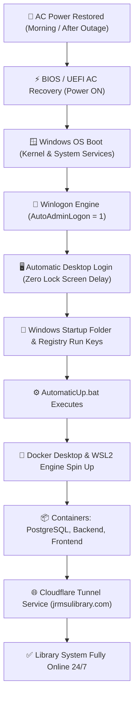

# JRMSU Library System - Windows Unattended Auto-Logon Architecture

## 1. Executive Summary & Purpose

The **JRMSU Katipunan Campus Library Server** runs a mission-critical web application, database, and Cloudflare tunnel that must remain accessible to students, faculty, and administrators across the campus and over the internet.

In a real-world campus deployment, the server encounters two frequent events:
1. **Scheduled Morning Power-On:** The library server is turned on each morning.
2. **Brownouts / Electrical Outages:** Power blips or localized campus blackouts temporarily drop power.

### The Problem Without Auto-Logon
When a Windows PC boots up, Windows halts at the **Interactive Sign-in / Lock Screen**. Because core server components:
- **Docker Desktop** (WSL2 engine)
- **AutomaticUp.bat** (Container health check, database migrations, port validation)
- User Startup tasks (`%APPDATA%\Microsoft\Windows\Start Menu\Programs\Startup`)

all run in the **User Session**, the entire library system remains **OFFLINE** until an IT administrator physically walks to the server PC, turns on the monitor, and types the Windows login password.

### The Solution: Headless Auto-Logon
By configuring Windows **AutoAdminLogon**, the server boots directly into the configured Windows account upon physical power restoration, automatically triggering:
1. Windows Desktop Session initialization
2. Docker Desktop daemon boot
3. `AutomaticUp.bat` execution (PostgreSQL, ASP.NET Core backend, Vite frontend)
4. Cloudflare Tunnel verification

The entire library portal restores to 100% operational status **in under 60 seconds with ZERO human intervention**.

---

## 2. Unattended Boot Chain Architecture



---

## 3. Included Automation Scripts

In `CommandStart`, two purpose-built scripts manage Auto-Logon:

| Script | Purpose | Elevation |
| :--- | :--- | :--- |
| `Setup-Windows-AutoLogon.bat` | Enables AutoLogon, prompts for credentials, configures Winlogon registry keys, and fixes Windows Hello PIN lockouts. | **Automatic UAC Elevation** |
| `Disable-Windows-AutoLogon.bat` | Safely turns off AutoLogon (`AutoAdminLogon=0`, `ForceAutoLogon=0`) and completely purges `DefaultPassword` from the registry. | **Automatic UAC Elevation** |

---

## 4. Winlogon Registry Specification

`Setup-Windows-AutoLogon.bat` configures the following keys under `HKLM\SOFTWARE\Microsoft\Windows NT\CurrentVersion\Winlogon`:

| Value Name | Type | Value | Description |
| :--- | :--- | :--- | :--- |
| `AutoAdminLogon` | `REG_SZ` | `"1"` | Instructs Windows to bypass the sign-in screen and log in automatically. |
| `DefaultUserName` | `REG_SZ` | `<TargetUser>` | The target Windows user account (defaults to current active user). |
| `DefaultDomainName` | `REG_SZ` | `<ComputerName>` | Local machine hostname or Active Directory domain. |
| `DefaultPassword` | `REG_SZ` | `<Password>` | Account password required by Windows Winlogon to authenticate. |
| `ForceAutoLogon` | `REG_SZ` | `"1"` | Forces automatic login even if someone logs off the session. |

### Windows 10/11 Windows Hello Bypass Fix
Windows 10 and 11 include a setting called *"Require Windows Hello sign-in for Microsoft accounts"* (`DevicePasswordLessBuildVersion = 2`), which suppresses standard Winlogon AutoLogon.

`Setup-Windows-AutoLogon.bat` automatically configures:
```cmd
reg add "HKLM\SOFTWARE\Microsoft\Windows NT\CurrentVersion\PasswordLess\Device" /v DevicePasswordLessBuildVersion /t REG_DWORD /d 0 /f
```
This guarantees that Windows credential provider honors the automated login request without requiring PIN interaction.

---

## 5. Security Considerations & Best Practices

### A. Physical Security of the Server
- The library server PC should be stationed in a locked office, IT workstation, or server cabinet.
- Auto-Logon provides physical desktop access upon boot. Physical security is the primary perimeter defense.

### B. Optional Post-Boot Auto-Lock (Best of Both Worlds)
If you want the PC to boot headless and start all services, but you do NOT want an unattended desktop left unlocked in a semi-public area:
You can have Windows lock the workstation 60 seconds after boot:
```cmd
timeout /t 60 /nobreak >nul
rundll32.exe user32.dll,LockWorkStation
```
*Result:* Docker and `AutomaticUp.bat` continue running in the background while the screen displays the locked screen.

### C. Temporary Emergency Bypass (Shift Key)
If you need to log into Windows as a different user (e.g., Administrator), **hold down the `Shift` key** while Windows is loading. Winlogon will temporarily ignore `AutoAdminLogon` for that boot session and display the login screen.

---

## 6. Microsoft Sysinternals Autologon Alternative

For administrators who prefer encrypted password storage instead of plain-text registry storage, Microsoft provides an official tool called **Autologon** (part of Sysinternals by Mark Russinovich).

### How Sysinternals Autologon Works
Instead of storing the password in `HKLM\SOFTWARE\Microsoft\Windows NT\CurrentVersion\Winlogon\DefaultPassword`, Sysinternals Autologon encrypts the password and stores it as an **LSA Secret** (`LsaStorePrivateData`).

### How to Use Sysinternals Autologon:
1. **Download:** Download `Autologon.zip` from Microsoft:
   - Official Link: [https://learn.microsoft.com/en-us/sysinternals/downloads/autologon](https://learn.microsoft.com/en-us/sysinternals/downloads/autologon)
2. **Extract:** Extract `Autologon.exe` (or `Autologon64.exe`) to your PC or into `CommandStart\`.
3. **Run via GUI:**
   - Run `Autologon64.exe` as Administrator.
   - Enter your username, domain/computer name, and password.
   - Click **Enable**.
4. **Run via CLI:**
   ```cmd
   autologon64.exe /accepteula <username> <domain> <password>
   ```
5. **To Disable via Sysinternals CLI:**
   ```cmd
   autologon64.exe /disable
   ```

*Note: Both our native batch scripts and Sysinternals Autologon configure the same Winlogon subsystem. Our batch scripts require zero external downloads and work out-of-the-box on clean Windows systems.*

---

## 7. BIOS/UEFI Setting for True 100% Unattended Boot

To make the Library Server fully autonomous after power blackouts, configure your computer's motherboard BIOS/UEFI:

1. Turn on the computer and immediately press **`DEL`** or **`F2`** repeatedly to enter BIOS/UEFI Setup.
2. Locate the **Power Management** or **Advanced ACPI** settings tab.
3. Find the setting named one of the following (depending on motherboard manufacturer):
   - **ASUS:** `Advanced -> APM Configuration -> Restore AC Power Loss -> Power On`
   - **Gigabyte:** `Settings -> Platform Power -> AC BACK -> Always On`
   - **Dell:** `Power Management -> AC Recovery -> Power On`
   - **HP:** `Advanced -> Power-On Options -> After Power Loss -> On`
   - **Lenovo:** `Power -> After Power Failure -> Power On`
4. Press **`F10`** to Save and Exit.

**Outcome:** As soon as power is restored to the wall socket, the computer turns on without anyone having to press the power button, logs in automatically via Auto-Logon, and launches the entire JRMSU Library System via `AutomaticUp.bat`!

---

## 8. Verification & Diagnostics Checklist

To verify your configuration is active and ready:

```cmd
:: 1. Check Winlogon AutoLogon status
reg query "HKLM\SOFTWARE\Microsoft\Windows NT\CurrentVersion\Winlogon" /v AutoAdminLogon

:: 2. Check AutoLogon username
reg query "HKLM\SOFTWARE\Microsoft\Windows NT\CurrentVersion\Winlogon" /v DefaultUserName

:: 3. Test Reboot
shutdown /r /t 10
```

To revert to standard manual login at any time, run:
```cmd
Disable-Windows-AutoLogon.bat
```
