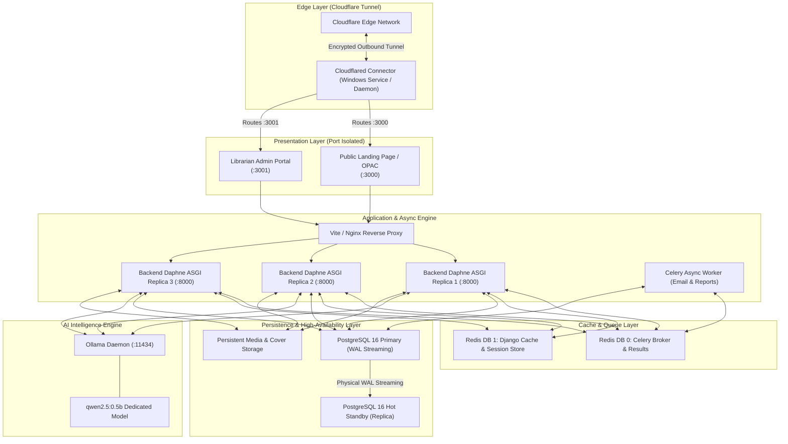
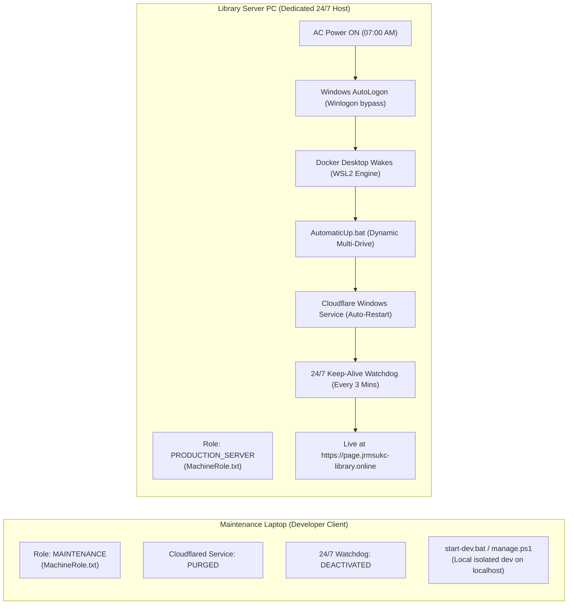
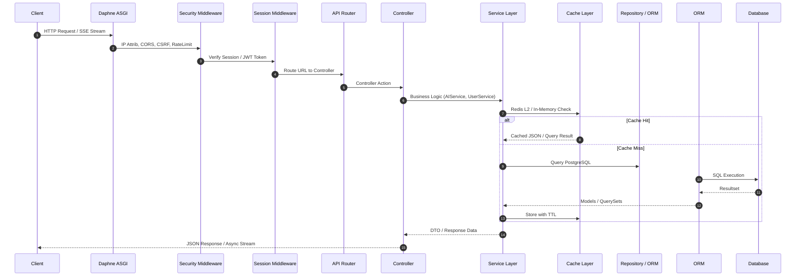
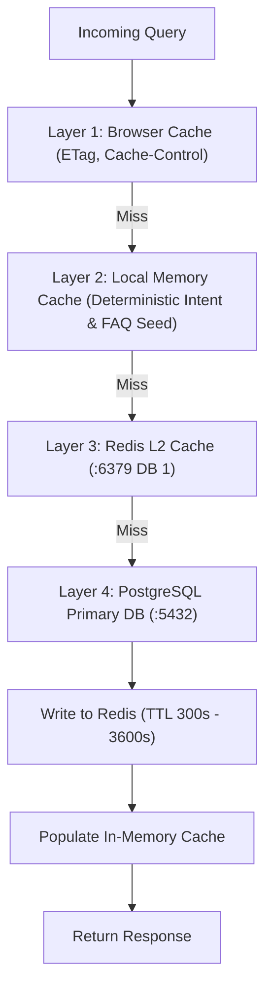
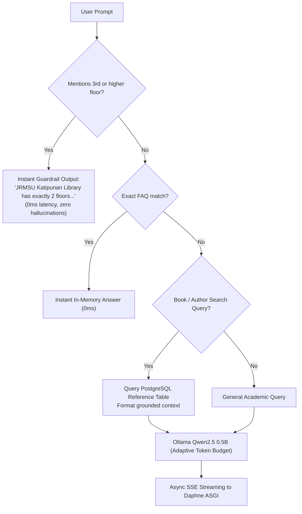
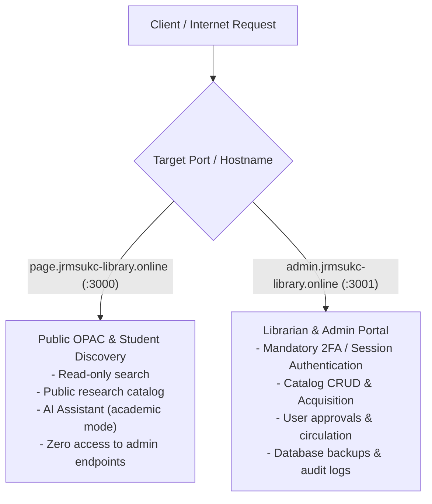

# JRMSU Katipunan Campus Library System
## Master Full-Stack Architecture, Algorithms & Operational Specification

---

## 1. Executive Overview & System Topology

The **JRMSU Katipunan Campus Library System** is an enterprise-grade academic library management and public access platform designed for 24/7 high availability, offline survivability, zero-hallucination AI discovery, and multi-port role-based isolation.

### 1.1 Complete Multi-Container Architecture (10 Microservices)



---

## 2. Production Deployment & Role Segregation Architecture

To prevent deployment collisions between physical hardware, the system enforces a strict **Dual-Machine Operational Topology**:



### 2.1 Role Invariant Rules
1. **The Laptop NEVER Serves Production**: `Configure-As-Maintenance-Laptop.bat` purges `Cloudflared` Windows Service, scheduled tasks, and autostart registry keys on the developer's laptop so closing the laptop never impacts public school DNS.
2. **The Library Server PC is Self-Healing**: `Configure-As-Library-Server.bat` provisions the auto-recovering Windows service (`sc failure Cloudflared reset= 86400 actions= restart/5000/restart/5000/restart/5000`), sets `127.0.0.1 host.docker.internal` in hosts, and arms the multi-drive watchdog.
3. **Headless Morning Wakeup**: `Setup-Windows-AutoLogon.bat` sets `AutoAdminLogon = 1` in `HKLM\SOFTWARE\Microsoft\Windows NT\CurrentVersion\Winlogon` so the server PC boots straight into desktop upon physical power-on without stalling at the lock screen.

---

## 3. Frontend Architecture (React + Vite + TypeScript + Tailwind)

### 3.1 Technology Stack & Directory Structure
- **Framework**: React 18 with Vite compiler, TypeScript strict typing.
- **Styling**: Tailwind CSS with custom academic library tokens, Lucide React icons.
- **State Management**: React Hooks (`useState`, `useEffect`, `useCallback`, `useMemo`, `useRef`), custom event buses.
- **Routing**: Client-side history navigation, hash-based tab navigation.

```
frontend/src/
├── Assets/              # Static branding, book cover fallbacks, FAQ cache
├── Components/          # Atomic and compound UI components
│   ├── BookModal.tsx    # Book detail viewer & reservation trigger
│   ├── ChatBot.tsx      # Real-time streaming AI discovery assistant
│   ├── Header.tsx       # Campus navigation bar & theme controls
│   ├── Hero.tsx         # Search bar, carousel, quick stats
│   ├── Footer.tsx       # Contact info, institutional accreditation
│   └── ...
├── Pages/               # Top-level route views
│   ├── HomePage.tsx     # Public OPAC & Discovery landing page
│   ├── AdminPage.tsx    # Librarian operations, circulation & inventory
│   ├── LoginPage.tsx    # Dual-port RBAC authentication entry
│   └── RegisterPage.tsx # Multi-step identity induction & biometric verification
└── Services/            # HTTP clients, Axios instances, CSRF handlers
```

### 3.2 Public Landing Page Patterns
- **Debounced Instant Search**: 300ms debounce interval preventing database query floods while user types titles, authors, or subjects.
- **Sticky Research Survey Note**: State-controlled persistent banner that can be toggled without redeploying code.
- **Fluid Layout**: Responsive fluid breakpoints (`xs: 475px`, `sm: 640px`, `md: 768px`, `lg: 1024px`, `xl: 1280px`, `2xl: 1536px`).

---

## 4. Backend Architecture (Django ASGI Daphne & .NET Standards)

### 4.1 Request Flowchain


### 4.2 Key Controllers & Responsibilities
- `user_controller.py`: Authentication, JWT issuance, session validation, heartbeat tracking (`last_active`).
- `ai_controller.py`: Chat query dispatch, deterministic intent resolution, streaming chunk generator.
- `reference_controller.py`: Book search, research catalog, subject classification, department inventories.
- `batch_controller.py`: Book acquisitions, batch logging, barcode & accession generation.
- `report_controller.py`: PDF & Excel circulation reports, automated monthly stats.
- `recycle_bin_controller.py`: Soft-delete governance, 30-day restore windows, permanent purge auditing.

---

## 5. Caching Strategy & Multi-Tier Invalidation Engine



### 5.1 Caching Tiers & TTL Policies
1. **L1 Client Cache**: Static assets, book cover thumbnails (Cache-Control: `max-age=86400, stale-while-revalidate=3600`).
2. **L2 In-Memory FAQ Cache**: Hardcoded institutional questions (library hours, borrowing limits, floor plan) resolved in `0ms` without contacting Redis or the LLM.
3. **L3 Redis Object Cache**:
   - `search_query_cache:*` (TTL: 300s, invalidated on book edit/create/delete).
   - `session_cache:*` (TTL: 86400s, refreshed on active user heartbeat).
   - `token_bucket:*` (TTL: 60s, rolling request quota).
4. **L4 Biometric Frame Cache**: During multi-step ID induction, webcam frames are buffered in memory and verified before persisting binary hashes.

---

## 6. AI Intelligence Engine & Anti-Hallucination Guardrails

### 6.1 Architectural Principles
- **Model**: Local Ollama container running `qwen2.5:0.5b`. Zero third-party API dependencies or cost.
- **Low-Latency First Token**: Time-to-First-Token (TTFT) minimized by aggressive prompt pruning and deterministic intent resolution.

### 6.2 Deterministic Query Resolution Flow
Before invoking the neural model, `AIService` checks the query against a deterministic intent engine:



### 6.3 3-Tier Adaptive Length Routing
The system calculates optimal token limits dynamically based on query classification:
- **Short Mode (Max 256 tokens)**: Simple queries, floor location, library hours, single book availability.
- **Medium Mode (Max 512 tokens)**: Multi-book recommendations, subject overviews, borrowing rules.
- **Long Mode (Max 1024 tokens)**: Research citations, literature reviews, comprehensive policy explanations.

---

## 7. Database Architecture & High-Availability Hot Standby

### 7.1 PostgreSQL Streaming Replication
The system implements physical streaming replication between two container instances:
1. **Primary Database (`db`)**:
   - Accepts read and write transactions.
   - `wal_level = replica`, `max_wal_senders = 10`, `max_replication_slots = 10`, `wal_keep_size = 128MB`.
2. **Hot Standby Replica (`db-standby`)**:
   - Accepts read-only analytics, search, and reporting queries.
   - Bootstrapped via `pg_basebackup -h db -U jrmsu_admin -D /var/lib/postgresql/data -Fp -Xs -P -R`.
   - Streaming replication with `hot_standby = on`.

### 7.2 Database Failover Protocol
In the event of primary database corruption or hardware fault:
- Running `powershell -File CommandStart/failover-to-standby.ps1` promotes `db-standby` to primary via `pg_ctl promote`.
- Automatic daily backups executed via `CommandStart/backup-db.ps1` with gzip compression and rolling 14-day retention.

---

## 8. Mathematical Formulas & Algorithmic Engines

### 8.1 Token Matching Algorithm (`_match_token_in_text`)
Prevents false-positive substring matches on short tokens while allowing prefix hits for longer words:
```python
def _match_token_in_text(token: str, text: str) -> float:
    t = token.lower().strip()
    txt = text.lower()
    if len(t) <= 3:
        # Require exact whole word match for tokens of 3 characters or less
        pattern = r'\b' + re.escape(t) + r'\b'
        return 5.0 if re.search(pattern, txt) else 0.0
    else:
        # Prefix or exact word scores highest
        pattern = r'\b' + re.escape(t)
        if re.search(pattern, txt):
            return 5.0
        elif t in txt:
            return 1.5
        return 0.0
```

### 8.2 Hybrid Relevance Scoring Formula
When ranking book and research catalog search results:
$$\text{Score} = 5.0 \cdot M_{\text{title}} + 3.0 \cdot M_{\text{author}} + 2.5 \cdot M_{\text{subject}} + 1.0 \cdot M_{\text{description}}$$
Where $M_{\text{field}} = \sum_{t \in \text{Tokens}} \_match\_token\_in\_text(t, \text{field})$.

### 8.3 Token Bucket Rate Limiting Formula
In `RateLimitMiddleware`, requests are throttled per IP using Redis:
$$B_{t} = \min(B_{\max}, B_{t-\Delta t} + r \cdot \Delta t)$$
Where:
- $B_{\max} = 60$ requests (Burst capacity).
- $r = 1.0$ tokens/second (Refill rate).
- If $B_{t} \ge 1$: Allow request, decrement bucket ($B_t \leftarrow B_t - 1$).
- If $B_{t} < 1$: Reject with HTTP 429 Too Many Requests.

### 8.4 Laplacian Variance Blur Detection Formula
For camera-captured ID and face frames:
$$\sigma^2 = \frac{1}{N} \sum_{x,y} \left( \nabla^2 I(x,y) - \mu \right)^2$$
Where $\nabla^2 I$ is the discrete Laplacian convolution kernel $\begin{bmatrix} 0 & 1 & 0 \\ 1 & -4 & 1 \\ 0 & 1 & 0 \end{bmatrix}$.
- If $\sigma^2 < 100$: Frame is blurry, reject with prompt to steady camera.
- If $\sigma^2 \ge 100$: Frame is sharp, proceed with biometric caching.

---

## 9. Multi-Port RBAC & Login Security Architecture

### 9.1 Multi-Port Isolation


### 9.2 Session Heartbeat Security Invariants
- **Active Session Tracking**: Heartbeat endpoint updates `last_active = timezone.now()` only for authenticated sessions.
- **Force Logout Guard**: If an administrator revokes a session or marks `is_active = False`, the heartbeat endpoint returns `HTTP 401 Unauthorized` with `{"status": "inactive"}`, instantly redirecting the client browser to the login screen.
- **Token Rotation**: Refresh tokens are single-use; issuing a new access token invalidates the preceding refresh token to prevent replay attacks.

---

## 10. Do's and Don'ts (The System Engineering Rules)

### Frontend
- **DO** use `useCallback` and `useMemo` on search ranking and filter pipelines.
- **DO** handle network disconnects with optimistic offline fallbacks.
- **DON'T** make synchronous blocking calls during AI streaming responses.
- **DON'T** hardcode API endpoints; always consume `/api` relative to current origin.

### Backend
- **DO** enforce token matching word boundaries (`_match_token_in_text`) to prevent 1-letter false positives.
- **DO** wrap database transactions in `@transaction.atomic` for multi-model writes (e.g. batch acquisitions).
- **DON'T** invoke Ollama directly in the HTTP request thread; always yield chunks via ASGI async generators.
- **DON'T** store raw user passwords; utilize Argon2 / PBKDF2 hashing algorithms.

### Operations & Deployment
- **DO** run `Configure-As-Library-Server.bat` as Administrator on the Library PC to ensure 24/7 Windows Service registration.
- **DO** execute `Configure-As-Maintenance-Laptop.bat` on maintenance laptops to de-escalate them from production.
- **DON'T** hardcode drive letters (`C:\`, `G:\`) or usernames (`provu`); always use `%~dp0` and dynamic path resolution.
- **DON'T** modify `.env` or production credentials in version control.
