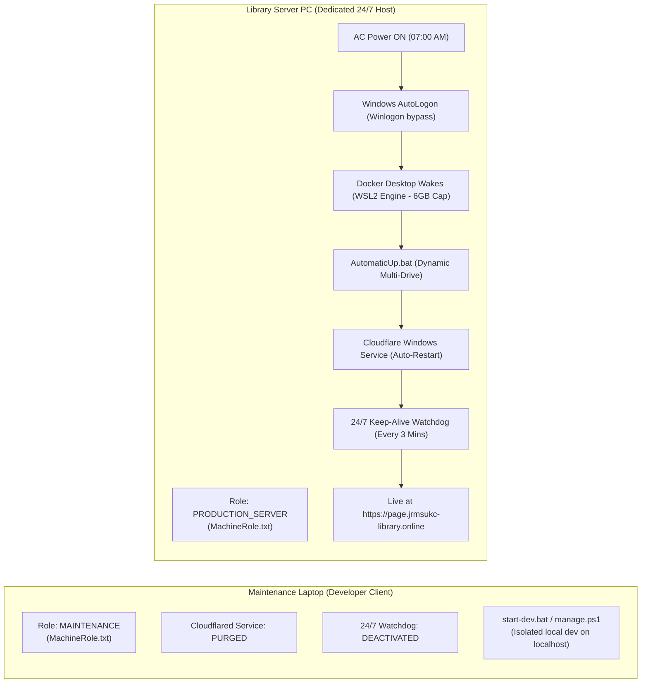
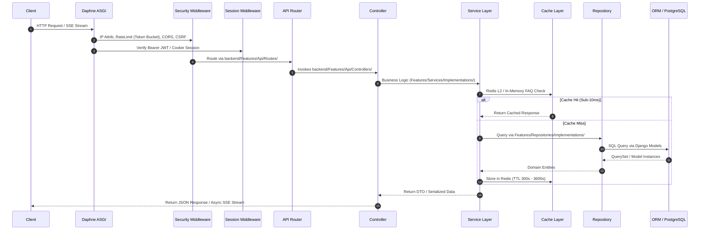
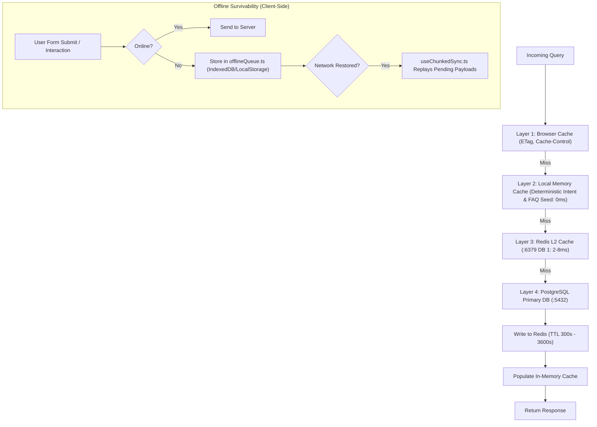
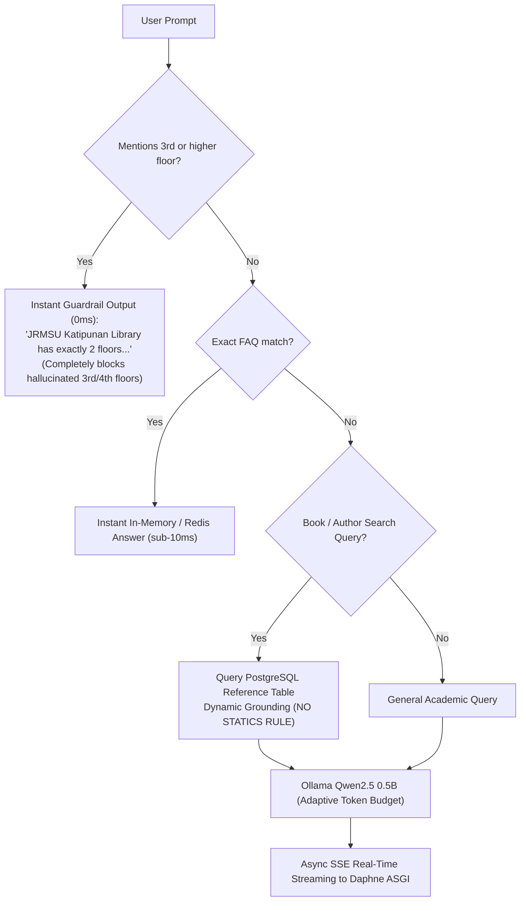
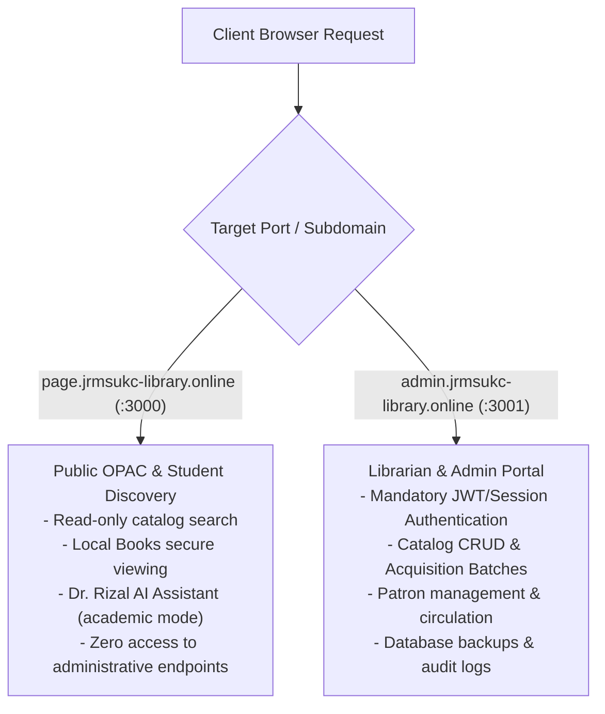
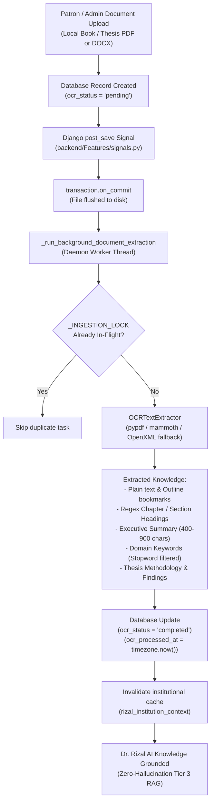

# JRMSU Katipunan Campus Library System
## Master Full-Stack Architecture, Algorithms & Operational Specification

> **Institution**: Jose Rizal Memorial State University (JRMSU) — Katipunan Campus  
> **Academic Year**: A.Y. 2026–2027 | **Timeline**: June 2026 – November 2026  
> **Standard**: Clean Architecture (Repository-Service Pattern) + Full Vertical-Slice + Global Calling Imports  
> **Current Version**: Production v2.4 (Fully Synchronized with Source Code & GitHub Repository Ledger)

---

## 1. Executive Overview & System Topology

The **JRMSU Katipunan Campus Library System** is an enterprise-grade academic library management, physical cataloging, and public Online Public Access Catalog (OPAC) platform. It is engineered for 24/7 high availability, offline survivability, zero-hallucination local AI discovery, and multi-port role-based physical access isolation.

### 1.1 Complete Multi-Container Architecture (9 Microservices Stack)

```mermaid
flowchart TD
    subgraph Edge["Edge Layer (Cloudflare Zero Trust Tunnel)"]
        CF_Edge["Cloudflare Edge Network\n(page.jrmsukc-library.online / admin.jrmsukc-library.online)"]
        CF_Agent["Cloudflared Connector (Windows Service / Daemon)"]
        CF_Edge <-->|Encrypted Outbound Tunnel (Zero Open Ports)| CF_Agent
    end

    subgraph Client["Presentation Layer (Port Isolated)"]
        Landing["Public Landing Page / OPAC\n(:3000) [frontend-webpage]"]
        Admin["Librarian Admin Portal\n(:3001) [frontend-admin]"]
    end

    subgraph App["Application & Async Worker Layer"]
        Backend["Backend Daphne ASGI / Django 5+ (:8000)\n[backend]"]
        Celery["Celery Async Worker (Email & Reports)\n[celery-worker]"]
    end

    subgraph Cache["Cache & Queue Layer"]
        Redis["Redis 7 Alpine (:6379)\nDB 0: Celery Broker & Results\nDB 1: Django Cache & Session Store"]
    end

    subgraph Data["Persistence & High-Availability Layer"]
        PG_Primary["PostgreSQL 16 Primary (:5432)\n[db] (WAL Level: replica)"]
        PG_Standby["PostgreSQL 16 Hot Standby\n[db-standby] (Streaming Replica)"]
        MediaVol["Persistent Storage (/app/media & Cover Art)"]
        CloudDB["Supabase Cloud Sync (Offsite Backup)"]
    end

    subgraph AI["AI Intelligence Engine"]
        Ollama["Ollama Container Daemon (:11434)"]
        Qwen["qwen2.5:0.5b Dedicated Quantized Model"]
    end

    CF_Agent -->|Routes Port 3000| Landing
    CF_Agent -->|Routes Port 3001| Admin
    Landing -->|HTTP / API Proxy| Backend
    Admin -->|HTTP / API Proxy| Backend
    Backend <--> Redis
    Backend <--> PG_Primary
    PG_Primary -->|Physical WAL Streaming| PG_Standby
    PG_Primary -.->|1-Click Sync (migrate-local-to-cloud)| CloudDB
    Backend <--> Ollama
    Ollama --- Qwen
    Celery <--> Redis
    Celery <--> PG_Primary
    Backend <--> MediaVol
```

---

## 2. Production Deployment & Role Segregation Architecture

To prevent deployment collisions between developer hardware and the dedicated physical 24/7 host machine, the system enforces a strict **Dual-Machine Operational Topology**:



### 2.1 Role Invariant Rules & CommandStart Suite
1. **The Maintenance Laptop NEVER Serves Production**:
   - `Configure-As-Maintenance-Laptop.bat` purges the `Cloudflared` Windows Service, unregisters autostart tasks, and deletes autostart registry entries from the developer's laptop so closing the laptop lid never impacts public school DNS.
2. **The Library Server PC is Self-Healing & Autonomous**:
   - `Configure-As-Library-Server.bat` provisions the auto-recovering Windows service (`sc failure Cloudflared reset= 86400 actions= restart/5000/restart/5000/restart/5000`), configures `127.0.0.1 host.docker.internal` in the Windows hosts file, and arms `AutomaticUp.bat`.
3. **Headless Morning Wakeup (Zero Human Intervention)**:
   - `Setup-Windows-AutoLogon.bat` sets `AutoAdminLogon = 1` in `HKLM\SOFTWARE\Microsoft\Windows NT\CurrentVersion\Winlogon` so the library PC boots straight into Windows upon physical AC power-on without stalling at the lock screen.
4. **Hardware RAM Optimization & Resource Cap**:
   - `Optimize-Server-RAM.bat` limits WSL2 virtual machine RAM to 6GB with 2GB swap (`.wslconfig`) to prevent Docker memory bloat from suffocating the host Windows OS.
5. **CommandStart Operational Suite Inventory**:
   - **Lifecycle**: `AutomaticUp.bat`, `StopAutomaticUp.bat`, `start-dev.bat`, `run.bat`, `stop-all.bat`, `hard-refresh.bat`, `cli.bat`.
   - **Database & Sync**: `backup-db.ps1`, `restore-db.ps1`, `restore-backup.bat`, `failover-to-standby.ps1`, `migrate-local-to-cloud.ps1`, `db-migrate.bat`.
   - **Cloudflare Tunnel**: `install-tunnel-service.bat`, `uninstall-tunnel-service.bat`, `run-tunnel.bat`, `fix-tunnel-502.bat`.
   - **Superadmin Tools**: `createsuperadmin.bat`, `customcreatesuperadmin.bat` (guided 10-char policy).
   - **Kubernetes**: `start-k8s.ps1`, `stop-k8s.ps1`.

---

## 3. Frontend Architecture (React 19 + TypeScript + Vite 6 + Tailwind v4)

### 3.1 Technology Stack & Global Calling Imports Standard
- **Core**: React 19, TypeScript 5.8, Vite 6, Tailwind CSS v4, React Router DOM v7.
- **Architectural Pattern**: Full Vertical-Slice Architecture with Global Calling Imports (`@/Shared`, `@/Hooks`, `@/LayoutBars`, `@/LayoutStyles`).
- **Path Aliases (`vite.config.ts` & `tsconfig.json`)**:
  ```ts
  alias: {
    '@/Shared': path.resolve(__dirname, './src/Shared'),
    '@/Hooks': path.resolve(__dirname, './src/Hooks'),
    '@/LayoutBars': path.resolve(__dirname, './src/LayoutBars'),
    '@/LayoutStyles': path.resolve(__dirname, './src/LayoutStyles'),
    '@': path.resolve(__dirname, '.'),
  }
  ```

### 3.2 Directory Structure & Component Tree
```text
frontend/src/
├── LayoutStyles/                                  # GLOBAL CALLING STYLES: Master styling & design tokens
│   ├── FontSyle/                                  # Typography & font definitions ONLY
│   │   └── fontStyles.css                         # Inter, Playfair Display, JetBrains Mono tokens & fluid rules
│   ├── MainLayout.css                             # Semantic color tokens, spacing variables, viewport & body layout
│   ├── PartLayout.css                             # Part utilities, pulse rings, modal animations, glassmorphism
│   └── index.css                                  # MASTER ENTRY: Imports fontStyles.css, MainLayout, PartLayout
│
├── LayoutBars/                                    # GLOBAL CALLING IMPORTS: Master Layout Frames
│   ├── Header.tsx                                 # Public floating glass navigation header (clock, search, nav)
│   ├── Footer.tsx                                 # Institutional library footer & accreditation
│   ├── AdminLayout.tsx                            # Admin console navigation drawer & top bar
│   ├── TopNavBar.tsx                              # Secondary top bar controls
│   └── index.ts                                   # MASTER BARREL EXPORT: import { Header, Footer, AdminLayout } from '@/LayoutBars'
│
├── Shared/                                        # GLOBAL CALLING IMPORTS: Universal UI Primitives
│   ├── Button.tsx                                 # Universal atomic button (7 variants, 4 sizes, icons, loading)
│   ├── Checkbox.tsx                               # Accessible checkbox (checked, unchecked, indeterminate '-')
│   ├── RadioButton.tsx                            # Accessible radio button & group primitive
│   ├── Dropdown.tsx                               # Dropdown selection menu with click-outside auto-close
│   ├── SearchBar.tsx                              # Glassmorphic search bar with clear button & debounced typing
│   ├── DefaultFloatingModalCard.tsx               # Universal floating modal (glass backdrop, ESC close, scroll lock)
│   ├── ModalCard.tsx                              # Responsive modal container card
│   ├── Drawer.tsx                                 # Universal slide-over drawer (left / right / bottom)
│   ├── SkeletonLoader.tsx                         # Shimmer loading skeletons (Line, Circle, Card, Page)
│   ├── Pagination.tsx                             # Universal table & list pagination controls
│   ├── DragDropFileUpload.tsx                     # Drag-and-drop file upload zone with progress bar
│   ├── ImageGallery.tsx                           # Responsive image viewer slider
│   ├── TreeView.tsx                               # Hierarchical tree explorer for Local Books & categories
│   ├── Charts/                                    # Universal interactive chart suite
│   │   ├── LinearCurveyChart.tsx                  # Spline curved area chart (circulation velocity)
│   │   ├── BarGraphChart.tsx                      # Histogram & bar chart visualizer
│   │   ├── PieGraphChart.tsx                      # Donut / pie chart visualizer
│   │   ├── HeatmapChart.tsx                       # 2D intensity density matrix
│   │   └── index.ts                               # Chart suite barrel export
│   └── index.ts                                   # MASTER BARREL EXPORT: import { ... } from '@/Shared'
│
├── Hooks/                                         # GLOBAL CALLING IMPORTS: Universal Utility Hooks (20 Hooks)
│   ├── usePagination.ts                           # Dynamic pagination math, clamping, and windowed numbers
│   ├── useFluidResponsiveness.ts                  # Viewport dimensions & responsive breakpoint detection
│   ├── useDebounce.ts                             # Universal debouncing hook (300ms search debounce)
│   ├── useToast.tsx / useToasts.ts                # Toast notification system
│   ├── useScrollbar.ts                            # Scroll position, scroll direction, and auto-hide tracking
│   ├── useAutoRefresh.ts                          # Interval polling & WebSocket update listener
│   ├── useGlobalAutoRefresh.ts                    # Central singleton auto-refresh engine
│   ├── useIntersectionObserver.ts                 # Viewport intersection & lazy loading
│   ├── useDraggableScroll.ts                      # Drag-to-scroll container hook
│   ├── useDraggableBubble.ts                      # Floating interactive bubble physics (Dr. Rizal bubble)
│   ├── useUndoDelete.ts                           # Soft-delete & undo state tracking
│   ├── useExcelParser.ts                          # Client-side Excel (.xlsx) bulk book parsing
│   ├── usePdfExport.ts                            # Printable PDF export for acquisition/circulation logs
│   ├── useChunkedSync.ts                          # Resilient large-payload synchronization
│   ├── useCmsUpdated.ts                           # Real-time CMS content invalidation trigger
│   ├── useAboutContent.ts                         # Dynamic institutional mission & vision cache
│   ├── useCarouselStyle.ts                        # Physics and rotation for 3D library setup
│   ├── useDevToolsProtection.ts                   # Security hook suppressing inspection tampering
│   └── index.ts                                   # MASTER BARREL EXPORT: import { ... } from '@/Hooks'
│
├── Features/                                      # Domain Vertical Slices (Owns business logic & subcomponents)
│   ├── Home/                                      # HeroSection, Live Clock, QuickStats, CampusMap
│   ├── Services/                                  # ServicesSection, ExternalServicesSection
│   ├── Feedback/                                  # FeedbackSection, FeedbackStickyCard
│   ├── Collection/                                # OPAC, NewlyAcquiredBooks, BlueModalCarousel, LocalBooks
│   ├── PhysicalSetup/                             # 3D LibrarySectionCarousel, FloorPlanVisualizer
│   ├── Personnel/                                 # PersonnelSection flowchart & staff directory
│   ├── AIAssistant/                               # RizalAssistant chat panel, RizalBubble floating trigger
│   ├── ResearchSurvey/                            # SurveyStickyCard, SurveyModal
│   ├── Auth/                                      # Login form, Multi-step biometric induction
│   ├── EResources/                                # Database proxy viewer, e-journal catalog
│   └── Admin/                                     # 13 Admin Management Modules:
│       ├── Analytics/                             # Real-time traffic, borrowing stats, charts
│       ├── BatchHistory/                          # Acquisition batches, barcode batches, logs
│       ├── BooksManager/                          # Catalog CRUD, Dewey decimal classifier, cover art
│       ├── ContentManager/                        # CMS text, links, policies, mission/vision
│       ├── Dashboard/                             # Librarian daily overview, quick counters
│       ├── EmailMessage/                          # Contact inquiries, AI auto-draft email replies
│       ├── EResourcesManager/                     # E-resource links, department folder taxonomy
│       ├── RecycleBin/                            # Soft-deleted records, 30-day restore, purge audit
│       ├── Reports/                               # PDF/Excel report generation engine
│       ├── SectionsManager/                       # Physical library zones, room setup photos
│       ├── Settings/                              # University configuration, semester dates, hours
│       └── UserManagement/                        # Patron accounts, role elevation, suspension
│
├── Pages/                                         # Route-Level Page Assemblies ONLY
│   ├── Home/HomePage.tsx                          # Public landing page
│   ├── About/AboutPage.tsx                        # Institutional about & history
│   ├── Services/ServicesPage.tsx                  # Library services catalog
│   ├── Administration/AdministrationPage.tsx      # Public governance & leadership
│   ├── Collection/CollectionPage.tsx              # OPAC Search & Local Books Tree View
│   ├── Personnel/PersonnelPage.tsx                # Staff organizational directory
│   ├── PhysicalSetup/PhysicalSetupPage.tsx        # 3D library layout & facilities
│   └── Admin/                                     # Admin Console Routes:
│       ├── AdminLayout.tsx                        # Layout wrapper
│       ├── DashboardPage.tsx                      # Dashboard view
│       ├── BooksManagerPage.tsx                   # Books manager
│       ├── BatchHistoryPage.tsx                   # Acquisition batch history
│       ├── EResourcesManagerPage.tsx              # E-resources manager
│       ├── SectionsManagerPage.tsx                # Sections manager
│       ├── ContentManagerPage.tsx                 # Content manager
│       ├── AnalyticsPage.tsx                      # Analytics view
│       ├── ReportsPage.tsx                        # Reports manager
│       ├── EmailMessagePage.tsx                   # Messages & AI drafts
│       ├── UserManagementPage.tsx                 # User accounts
│       ├── RecycleBinPage.tsx                     # Recycle bin
│       ├── SettingsPage.tsx                       # System settings
│       └── LoginPage.tsx                          # Admin secure login
│
├── Components/Modals/                             # Dedicated Overlay Viewports
│   ├── BookListModal.tsx                          # Batch book listing modal
│   ├── ExternalIframeModal.tsx                    # Subscribed e-resource proxy viewport
│   ├── FileViewerModal.tsx                        # Secure Read-Only Local PDF/document viewer
│   └── NotificationDetailModal.tsx                # System notice inspector
│
├── Endpoints/                                     # Typed API Client Services (15 Modules)
│   ├── aiApi.ts, batchApi.ts, bulkApi.ts, cmsApi.ts, contactApi.ts, eresourceApi.ts,
│   ├── feedbackApi.ts, galleryApi.ts, notificationApi.ts, personnelApi.ts, recycleApi.ts,
│   └── referenceApi.ts, reportApi.ts, settingsApi.ts, userApi.ts
│
├── Libs/                                          # Core infrastructure (apiClient, offlineQueue)
└── App.tsx                                        # Master application router & tab provider
```

---

## 4. Backend Clean Architecture (Django ASGI Daphne + Repository-Service Pattern)

The backend follows the **Clean Architecture / ASP.NET-style Repository-Service Pattern** implemented inside Django REST Framework. Controllers never make direct database queries; business logic resides strictly in Services, and persistence is encapsulated in Repositories.

### 4.1 Request Flowchain


### 4.2 Complete Controller Inventory (`backend/Features/Api/Controllers/`)
The backend provides **17 dedicated controllers**:
1. `ai_controller.py`: Chat query dispatch, 2-floor guardrail validation, streaming token SSE generation, and dynamic collection grounding.
2. `analytics_controller.py`: Real-time circulation velocity, catalog composition histograms, visitor frequency curves.
3. `batch_controller.py`: Acquisition Batch History, accession tracking, donation/purchase logging.
4. `bulk_controller.py`: Server-side Excel (`.xlsx`) validation, bulk book ingestion, batch conflict detection.
5. `cms_controller.py`: Landing page dynamic content, institutional policies, mission/vision text.
6. `contact_controller.py`: Visitor messages, attachment uploads, automated confirmation notifications.
7. `csrf_controller.py`: Secure CSRF token generation and validation.
8. `external_proxy_controller.py`: CORS-sanitized iframe proxying for external academic e-resources.
9. `feedback_controller.py`: Student library ratings, sentiment feedback collection, and moderation.
10. `health_controller.py`: Container health probes (`/api/health/`), Redis ping, PostgreSQL readiness check.
11. `notification_controller.py`: Room reservation status updates, broadcast notices, borrower reminders.
12. `personnel_controller.py`: Staff roster, organizational hierarchy positions, contact emails.
13. `recycle_bin_controller.py`: Soft-delete recovery, 30-day purge countdown, administrative audit logging.
14. `reference_controller.py`: OPAC search, Dewey decimal classification, subject tagging, book detail queries.
15. `report_controller.py`: Export engine producing printable PDF and Excel acquisition/circulation reports.
16. `settings_controller.py`: Library operational schedule, borrowing rules, emergency banner controls.
17. `user_controller.py`: Authentication, JWT issuance, heartbeat session tracking (`last_active`), and terminal superadmin isolation.

### 4.3 Complete Repository Inventory (`backend/Features/Repositories/`)
Structured cleanly with **Interfaces** and **Implementations** (16 Repositories):
- `ai_faq_repository.py`
- `analytics_repository.py`
- `batch_repository.py`
- `book_repository.py`
- `cms_repository.py`
- `contact_repository.py`
- `eresource_repository.py`
- `feedback_repository.py`
- `gallery_repository.py`
- `notification_repository.py`
- `personnel_repository.py`
- `recycle_bin_repository.py`
- `reference_repository.py`
- `report_repository.py`
- `settings_repository.py`
- `user_repository.py`

### 4.4 Complete Service Inventory (`backend/Features/Services/`)
Structured cleanly with **Interfaces** and **Implementations** (16 Services + Async Task Engine):
- `ai_service.py` (Local Ollama inference orchestration, prompt pruning)
- `analytics_service.py`
- `batch_service.py`
- `book_service.py`
- `cms_service.py`
- `contact_service.py`
- `eresource_service.py`
- `feedback_service.py`
- `gallery_service.py`
- `notification_service.py`
- `personnel_service.py`
- `recycle_bin_service.py`
- `reference_service.py`
- `report_service.py`
- `settings_service.py`
- `user_service.py`
- `tasks.py` (Celery background task worker for asynchronous email delivery and scheduled report aggregation)

### 4.5 Complete Data Model Inventory (`backend/Features/Data/Models/`)
All database entities are compartmentalized under `Features/Data/Models/` (20 Models):
1. `account_model.py`: Custom user entity with RBAC roles, terminal-admin flag (`is_terminal_created`), and session timestamps.
2. `acquisition_batch_model.py`: Book procurement batches, supplier metadata, batch status.
3. `ai_faq_cache_model.py`: Semantic FAQ questions, pre-computed answers, and match counts.
4. `batch_history_model.py`: Historical ledger of physical acquisitions and donations.
5. `contact_attachment_model.py`: File attachments sent via visitor contact submissions.
6. `contact_message_model.py`: Visitor inquiries, read status, and AI auto-drafted email replies.
7. `eresource_model.py`: Subscribed academic resources, departmental eBooks, and file paths.
8. `feedback_model.py`: Visitor ratings (1-5 stars) and qualitative feedback.
9. `generated_report_model.py`: Persisted metadata for generated PDF/Excel audit reports.
10. `library_interior_image_model.py`: Photographs of library sections, study carrels, and 3D physical setups.
11. `managed_file_model.py`: General downloadable institutional PDFs and library guides.
12. `managed_link_model.py`: Institutional links, partner universities, and research databases.
13. `newly_acquired_book_model.py`: Physical books showcased on the public landing carousel.
14. `page_content_model.py`: Editable CMS page sections, guidelines, and announcements.
15. `page_image_model.py`: Hero banners and branding graphic assets.
16. `personnel_model.py`: Library personnel, designations, credentials, and hierarchy rank.
17. `recycle_bin_model.py`: Soft-deleted records tracking model name, original ID, and deletion metadata.
18. `research_reference_model.py`: Full OPAC catalog collection, Dewey call numbers, ISBN, and physical shelf coordinates.
19. `site_settings_model.py`: Global site metadata, opening hours, active semester settings, and maintenance modes.
20. `site_visit_model.py`: IP-anonymized traffic analytics logs for institutional circulation reporting.

---

## 5. Caching Strategy, Multi-Tier Invalidation & Offline Survivability



### 5.1 Caching Tiers & TTL Policies
1. **L1 Client Browser Cache**: Static assets, book cover thumbnails (Cache-Control: `max-age=86400, stale-while-revalidate=3600`).
2. **L2 In-Memory FAQ Cache**: Hardcoded institutional questions (library hours, borrowing limits, floor count) resolved in `0ms` without network overhead.
3. **L3 Redis 7 Object Cache**:
   - `search_query_cache:*` (TTL: 300s, invalidated on book edit/create/delete).
   - `session_cache:*` (TTL: 86400s, refreshed on active user heartbeat).
   - `token_bucket:*` (TTL: 60s, rolling request quota).
4. **Offline Request Queue (`offlineQueue.ts`)**:
   - Automatically intercepts API submissions if the campus Wi-Fi drops.
   - Preserves form data in local storage and replays transactions asynchronously upon reconnection via `useChunkedSync.ts`.

---

## 6. AI Intelligence Engine & Anti-Hallucination Guardrails

### 6.1 Architectural Principles
- **Model**: Local Ollama container running `qwen2.5:0.5b` (quantized local inference).
- **Cost**: 100% free, zero external API keys or cloud egress fees.
- **Privacy**: Student queries and research queries never leave the campus physical server.

### 6.2 Deterministic Intent Resolution & Non-Existent Floor Guardrail
Before invoking the neural model, `AIService` passes the prompt through deterministic rule engines:



### 6.3 3-Tier Adaptive Length Routing
To maximize response speed and eliminate trailing truncation:
- **Short Mode (Max 256 tokens)**: Simple queries, floor location, library hours, single book availability (1–2 seconds response time).
- **Medium Mode (Max 512 tokens)**: Multi-book recommendations, subject overviews, borrowing rules (2–4 seconds response time).
- **Long Mode (Max 1024 tokens)**: Literature reviews, research methodology assistance, comprehensive policy explanations.

### 6.4 AI Auto-Draft Email Replies
- Librarian staff reviewing incoming contact messages in `/admin/email-messages` can generate context-aware draft replies with 1-click via local Ollama.
- Drafts are editable before dispatch, maintaining human-in-the-loop oversight.

---

## 7. Database Architecture, High-Availability & Terminal Admin Protection

### 7.1 Multi-Database Support & Hot Standby Streaming Replication
The platform supports dual database environments:
- **Local Bare-Metal Development**: Microsoft SQL Server / Local PostgreSQL.
- **Docker Production Stack**: PostgreSQL 16 Alpine Primary (`db`) with physical streaming replication to `db-standby`.
  - Primary configuration: `wal_level = replica`, `max_wal_senders = 10`, `max_replication_slots = 10`, `wal_keep_size = 128MB`.
  - Standby configuration: Bootstrapped via `pg_basebackup`, starts with `hot_standby = on`.
  - Emergency failover executed via `powershell -File CommandStart/failover-to-standby.ps1`.
- **Cloud Disaster Recovery Sync**:
  - `migrate-local-to-cloud.ps1` replicates local records to Supabase Cloud PostgreSQL.
  - `python manage.py verify_cloud_sync` audits parity across all 20 models.

### 7.2 Terminal Superadmin Protection
To prevent accidental or malicious deletion of core system access:
- Superadmin accounts created via terminal commands (`createsuperadmin.bat` or `python manage.py createsuperuser_custom`) are tagged with `is_terminal_created = True`.
- Web admin interface disables the "Delete" and "Suspend" actions for these protected accounts.
- Terminal admins can only be pruned via `python manage.py deletespecificsuperuser`.

### 7.3 Automated Assets Ingestion Suite
- `python manage.py imports_assets`: Ingests e-books, cover art, and interior facility photographs from `frontend/src/Assets/assets` into the database and media volume.
- `python manage.py imports_assets --reset`: Performs clean-wipe re-import when resetting catalog state.

---

## 8. Security Hardening & Local Books (Tree View) Read-Only File Protection

### 8.1 Local Books Read-Only File Protection Architecture
The Local Books and E-Resource collection (`/collection/local-books`, `FileViewerModal.tsx`, and `SecurePdfViewer.tsx`) implements a 5-layer anti-download protection architecture:
1. **HTML5 Canvas Rasterization Engine (`SecurePdfViewer.tsx` via `pdfjs-dist`)**:
   - Replaces vulnerable browser `<iframe src="file.pdf">` viewports with pure HTML5 `<canvas>` elements.
   - PDF binary streams are parsed in memory; individual pages are rendered strictly as pixel graphics onto the canvas. Because there are no `<embed>`, `<object>`, or PDF iframe elements in the DOM, the browser's native PDF download engine cannot hook into the document.
2. **Click-Jacking & Context Menu Interception Shield**:
   - A transparent overlay div covers the canvas viewport (`pointer-events-auto`), suppressing right-click context menus (`onContextMenu={(e) => e.preventDefault()}`) and preventing image/element drag-and-drop.
3. **Keyboard Action Interception & Real-Time Security Warning**:
   - Event listeners intercept download and export keyboard shortcuts (`Ctrl+S`, `Ctrl+P`, `Ctrl+U`, `F12`, `Ctrl+Shift+I/C/J`), immediately halting the action and displaying a floating security warning banner: *"Downloading and printing this document are prohibited under JRMSU Library Read-Only Policy."*
4. **Permanent Diagonal Institutional Watermark**:
   - A semi-transparent institutional watermark (`"JRMSU KATIPUNAN CAMPUS LIBRARY • OFFICIAL READ-ONLY PATRON COPY • DO NOT DISTRIBUTE"`) is layered across all page canvases at a -35° angle, deterring screen captures and manual photographic redistribution.
5. **Hardened Backend Media Serve (`backend/core/urls.py`)**:
   - Replaces basic static file serving with `secure_media_serve` injecting mandatory security headers:
     - `Content-Disposition: inline` (prevents browser attachment downloading)
     - `X-Content-Type-Options: nosniff` (mitigates MIME-sniffing exploits)
     - `Cache-Control: private, no-transform, max-age=3600`
     - `X-Frame-Options: SAMEORIGIN` (prevents external click-jacking embedding)

### 8.2 Laplacian Variance Blur Detection
For student identity card capture during registration:
$$\sigma^2 = \frac{1}{N} \sum_{x,y} \left( \nabla^2 I(x,y) - \mu \right)^2$$
Where $\nabla^2 I$ is the discrete Laplacian convolution kernel $\begin{bmatrix} 0 & 1 & 0 \\ 1 & -4 & 1 \\ 0 & 1 & 0 \end{bmatrix}$.
- If $\sigma^2 < 100$: Frame is flagged blurry; prompts user to steady the document.
- If $\sigma^2 \ge 100$: Frame is sharp; proceeds to crop and cache.

### 8.3 Hybrid Relevance Search Algorithm
OPAC book discovery utilizes weighted multi-token field scoring:
$$\text{Score} = 5.0 \cdot M_{\text{title}} + 3.0 \cdot M_{\text{author}} + 2.5 \cdot M_{\text{subject}} + 1.0 \cdot M_{\text{description}}$$
Where token boundary matching (`_match_token_in_text`) prevents false-positive substring matches on 1-to-3 character words.

---

## 9. Multi-Port RBAC & Port Routing



- **Active Heartbeat Tracking**: Client sends a background heartbeat every 60 seconds; `user_controller.py` updates `last_active`.
- **Instant Force-Logout**: If a user is deactivated or an admin revokes permissions, subsequent heartbeat requests return `HTTP 401 Unauthorized` (`{"status": "inactive"}`), instantly redirecting the client browser to `/admin/login`.

---

## 10. Engineering Rules (Do's and Don'ts)

### Frontend
- **DO** import all shared primitives, hooks, and layout components via their Global Calling Imports (`@/Shared`, `@/Hooks`, `@/LayoutBars`, `@/LayoutStyles`).
- **DO** debounce text inputs (300ms via `useDebounce`) to avoid redundant API floods.
- **DO** handle network drops gracefully via `offlineQueue.ts`.
- **DON'T** make direct relative imports reaching across feature boundaries (e.g., `../../Components/...`); use barrel exports.
- **DON'T** expose raw static file URLs with download headers for copyrighted Local Books collection documents.

### Backend
- **DO** adhere strictly to the Controller -> Service -> Repository -> Model flowchain.
- **DO** wrap multi-record database operations in `@transaction.atomic`.
- **DO** enforce token boundary word checks (`_match_token_in_text`) in reference queries.
- **DON'T** make database ORM calls directly inside controllers.
- **DON'T** query external LLM APIs; all AI queries must target local Ollama (`qwen2.5:0.5b`).

### Operations & Deployment
- **DO** run `Configure-As-Library-Server.bat` as Administrator on the Library PC to ensure 24/7 self-healing services.
- **DO** execute `Configure-As-Maintenance-Laptop.bat` on developer laptops before closing them to prevent Cloudflare tunnel conflicts.
- **DON'T** hardcode drive letters (`C:\`, `G:\`) or usernames (`provu`); always rely on `%~dp0` dynamic path resolution.
- **DON'T** commit sensitive secrets, `.env` files, or production credentials to GitHub.

---

## 11. Document Security & Automated OCR Knowledge Extraction Engine

### 11.1 Zero-Download Protected Canvas Architecture
To strictly safeguard institutional and local collection assets from unauthorized downloads, printing, or content scrapers, the system implements client-side pure HTML5 Canvas rasterization across all document viewers:

| Security Layer | Implementation Component | Defense Mechanism |
| :--- | :--- | :--- |
| **Canvas Rasterization** | `SecurePdfViewer.tsx`, `ReferenceFileViewerModal.tsx` | Pure 2D Canvas rendering via `pdfjs-dist`; no raw `<iframe>`, `<embed>`, `<object>`, or static PDF URLs rendered in DOM. |
| **Interception Shield** | Transparent `absolute inset-0 z-10` overlay | Sits directly above the canvas element; blocks direct context menu triggers, right-click, and mouse drag-to-desktop gestures. |
| **Shortcut Suppressor** | Capture-phase global keydown listener (`capture=true`) | Traps `Ctrl+S`, `Cmd+S`, `Ctrl+P`, `Cmd+P`, `Ctrl+U`, `F12`, and `Ctrl+Shift+I/C/J`; triggers warning toasts. |
| **Dynamic Watermarking** | Canvas 2D matrix transform + overlay watermark | Semi-transparent `-35°` institutional warning text rendered directly onto the document bitmap and container. |
| **Backend Inline Headers** | `secure_media_serve` / Django media router | Sends `Content-Disposition: inline` and `X-Content-Type-Options: nosniff`; prevents browser download prompt. |

### 11.2 Automated OCR & Multi-Format Knowledge Extraction Pipeline
To enable Dr. Jose Rizal AI Assistant to answer detailed patron questions about specific book contents, syllabus chapters, and research findings, a local OCR text extraction engine parses uploaded files and indexes structured knowledge into the database:



- **Autonomous Knowledge Extraction Daemon**: `AutonomousKnowledgeDaemon` (`backend/Features/Helpers/autonomous_knowledge_daemon.py`) runs continuously in the background of the Daphne/WSGI server process. It automatically sweeps and indexes all unextracted documents on server boot (`FeaturesConfig.ready()`), runs periodic sweeps every 5 minutes, and responds immediately to `AutonomousKnowledgeDaemon.trigger_now()` called by upload controllers. No manual CLI commands are required in production.
- **CLI Management Command**: `python manage.py extract_file_knowledge [--force] [--limit N]` remains available for optional manual administrative auditing or batch re-indexing.
- **Authentic JRMSU University UI**: Document viewing in `FileViewerModal.tsx` strictly adheres to the official JRMSU design system (Royal Blue gradient `from-blue-900 to-blue-600`, Google `material-symbols-outlined`, white container cards `rounded-2xl`, and light gray canvas backdrop), eliminating artificial dark AI banners while maintaining 100% canvas anti-download security.
- **AI Service Dynamic Grounding**: `ai_service.py` intercepts document content queries via `is_document_knowledge_query`, dynamically injects relevant verified chapters and research findings into the prompt, and enforces Rule 9 ("Zero Hallucination Policy").
